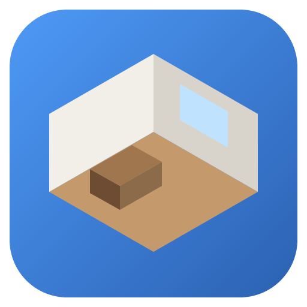

# Amoblador3D

Aplicación de escritorio para diseñar habitaciones en 3D con **medidas reales**: paredes, puertas y ventanas, iluminación con sombras y muebles que no atraviesan paredes ni otros muebles.

Hecha con **Electron + Vite + Three.js**. Todas las medidas están en metros (1 unidad de Three.js = 1 m).



## Requisitos

- [Node.js](https://nodejs.org) 20 o superior.

## Comandos

| Comando | Qué hace |
|---|---|
| `npm install` | Instala las dependencias (solo la primera vez). |
| `npm run dev` | Modo desarrollo: abre la app con recarga automática y las DevTools. |
| `npm start` | Compila y abre la versión de producción. |
| `npm run dist` | Crea el instalador de Windows en `release/`. |
| `npm run dist:dir` | Crea la app sin instalador (`release/win-unpacked/`), más rápido para probar. |
| `npm run icon` | Regenera `build/icon.png`. |
| `npm run models:samples` | Regenera los modelos de ejemplo de `assets/models/`. |

## Uso

1. **Habitación**: escribe ancho, largo, alto y grosor de muro, y pulsa *Aplicar medidas*. Las medidas son **interiores** (el espacio libre); los muros crecen hacia afuera.
2. **Ventanas y puertas**: *+ Ventana* / *+ Puerta* y edítalas en el panel derecho (pared, posición desde la esquina, ancho, alto, alféizar).
3. **Iluminación**: luz ambiental, *Bombilla* (puntual), *Foco* (cono dirigido) y *Sol* (entra por una ventana). Color, intensidad y sombras en el panel derecho.
4. **Muebles**: elige uno del catálogo; arrástralo con el ratón; edita posición, rotación, medidas y color en el panel derecho.
5. **Proyecto**: *Guardar* / *Abrir* (archivos `.amob3d`), *Deshacer* / *Rehacer*, *Captura* (PNG en alta resolución con cotas).

La vista se controla con el ratón: botón izquierdo gira (en planta, mueve), botón derecho mueve, rueda acerca.
En 3D, las paredes que tapan la vista se vuelven invisibles automáticamente.

### Atajos de teclado

| Atajo | Acción |
|---|---|
| Ctrl+N / Ctrl+O / Ctrl+S / Ctrl+Shift+S | Nuevo / Abrir / Guardar / Guardar como |
| Ctrl+Z / Ctrl+Y | Deshacer / Rehacer |
| Ctrl+E | Exportar imagen |
| Ctrl+I | Importar modelo 3D |
| Ctrl+D | Duplicar mueble |
| Supr | Eliminar selección |
| Esc | Deseleccionar |
| R / Shift+R | Girar mueble 90° |
| Q / E | Girar mueble 15° |
| Flechas (Shift) | Mover mueble 5 cm (1 cm) |
| Ctrl+1 / Ctrl+2 | Vista 3D / Planta 2D |
| Ctrl+M | Mostrar/ocultar cotas |
| Ctrl+0 | Centrar cámara |
| F1 | Ver atajos |

## Agregar muebles al catálogo

### Opción A: desde la aplicación (recomendada)

*Archivo → Importar modelo 3D* (o el botón *Importar .glb/.gltf…*). Elige el archivo, escribe sus medidas reales y listo.
Los modelos importados se guardan en la carpeta de datos del usuario (*Archivo → Abrir carpeta de modelos importados*).

### Opción B: sin tocar código, editando `assets/catalog.json`

1. Copia el modelo `.glb` (o `.gltf` con sus archivos `.bin` y texturas) en `assets/models/`.
2. Agrega una entrada en `assets/catalog.json`:

```json
{
  "id": "mi-sillon",
  "name": "Sillón",
  "file": "models/mi-sillon.glb",
  "width": 0.9,
  "depth": 0.85,
  "height": 0.95,
  "rotation": 0
}
```

| Campo | Significado |
|---|---|
| `id` | Identificador único (sin espacios). Se guarda en los proyectos. |
| `name` | Nombre visible en el botón. |
| `file` | Ruta del modelo, relativa a `assets/`. |
| `width`, `depth`, `height` | Medidas **reales** en metros (ancho X, profundidad Z, alto Y). |
| `rotation` | Grados para girar el modelo de modo que su frente mire a +Z (0, 90, 180 o 270). |

3. *Archivo → Recargar catálogo* (o reinicia la app).

El modelo se escala automáticamente a las medidas indicadas, sin importar si fue modelado en metros, centímetros o milímetros.
En la app instalada, la carpeta `assets` está en `C:\Users\<usuario>\AppData\Local\Programs\Amoblador3D\resources\assets`.

**Dónde conseguir modelos gratuitos (.glb):** [Poly Haven](https://polyhaven.com/models), [Sketchfab](https://sketchfab.com) (filtrar por *Downloadable*), [Kenney](https://kenney.nl/assets) (*Furniture Kit*). Revisa la licencia de cada modelo.
No se admiten modelos comprimidos con Draco/Meshopt.

### Opción C: mueble paramétrico (por código)

En `src/catalog/parametric.js` crea una función `build({ width, depth, height, color })` que devuelva un `THREE.Group` y regístrala en `PARAMETRIC`. Regla: el mueble debe ocupar exactamente `x ∈ [-w/2, w/2]`, `z ∈ [-d/2, d/2]`, `y ∈ [0, h]`, con el frente hacia +Z.

## Estructura del proyecto

```
assets/              catálogo incluido (catalog.json + models/)
build/               icono de la aplicación
scripts/             generadores del icono y de los modelos de ejemplo
src/
  main/              proceso principal de Electron
    main.js            ventana, aviso de cambios sin guardar
    menu.js            menú nativo
    ipc.js             archivos: proyectos, imágenes, catálogo, protocolo amob://
    preload.cjs        puente seguro entre la interfaz y el proceso principal
  renderer/          interfaz (HTML/CSS) y su lógica
    main.js            conecta todo: selección, acciones, guardado, historial
    ui/                formulario de habitación, panel de propiedades, diálogo de importación
  scene/             todo lo 3D
    SceneManager.js    renderizador, cámaras 3D y planta, captura
    Room.js            piso, paredes con huecos, techo, cotas
    Openings.js        ventanas y puertas
    Lights.js          luces
    Furniture.js       muebles y colisiones con paredes, muebles y puertas
    collision.js       intersección de rectángulos rotados (SAT)
    Interaction.js     clic y arrastre con el ratón (raycasting)
    Dimensions.js      cotas
  catalog/           catálogo de muebles (paramétricos + modelos glTF)
  storage/           formato de proyecto y deshacer/rehacer
```

## Formato del proyecto (.amob3d)

Es JSON legible:

```json
{
  "app": "Amoblador3D",
  "version": 1,
  "room": { "width": 4, "length": 3.5, "height": 2.5, "wallThickness": 0.15 },
  "openings": [{ "id": "window-1", "type": "window", "wall": "norte", "offset": 1.4, "width": 1.2, "height": 1, "sill": 0.9 }],
  "ambient": 0.6,
  "lights": [{ "id": "point-1", "type": "point", "color": "#ffe2b8", "intensity": 6, "castShadow": true, "x": 2, "y": 2.25, "z": 1.75 }],
  "furniture": [{ "id": "cama-1", "type": "cama", "x": 2, "z": 1.6, "rotation": 0, "width": 1.4, "depth": 1.9, "height": 0.9, "color": "#8b6b4a" }]
}
```

Coordenadas: el origen es la esquina interior **noroeste** a nivel del piso; X crece hacia el este, Z hacia el sur, Y hacia arriba.

## Problemas conocidos

- **Windows SmartScreen** avisa al instalar porque el instalador no está firmado digitalmente: *Más información → Ejecutar de todas formas*.
- Si `npm run dev` abre una consola de Node en vez de la ventana, la variable de entorno `ELECTRON_RUN_AS_NODE` está definida; ábrelo desde una terminal normal.
