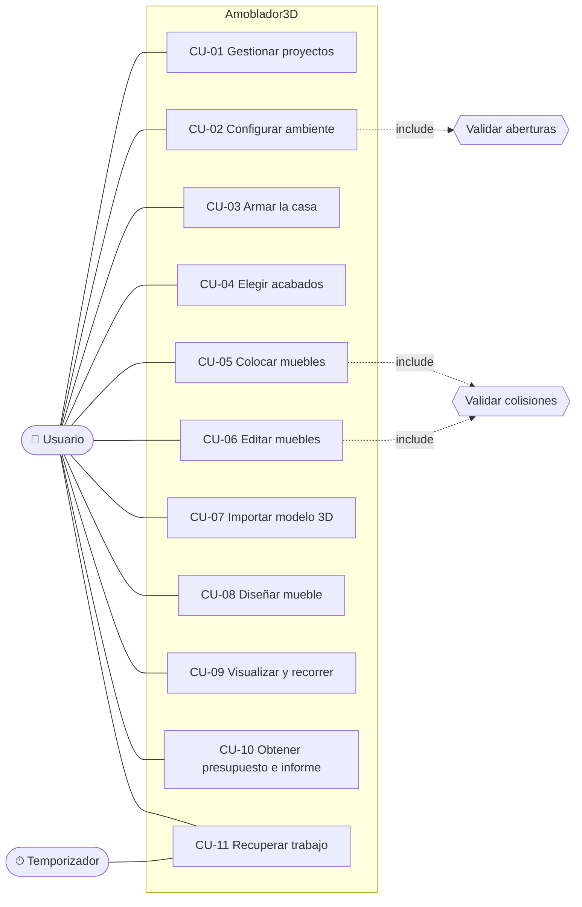

# 03 · Casos de uso

Versión 1.0 · noviembre de 2026

## 1. Actores

| Actor | Tipo | Descripción |
|---|---|---|
| Usuario | Principal | Persona que diseña y amobla sus ambientes |
| Sistema de archivos | Secundario | Donde se leen y escriben `.amob3d`, `.glb`, PNG, CSV y PDF |
| Temporizador de autoguardado | Secundario | Dispara la copia de recuperación cada 60 s |

## 2. Diagrama de casos de uso

## 3. Especificación de casos de uso

### CU-01 Gestionar proyectos

| Campo | Descripción |
|---|---|
| Actor | Usuario |
| Requisitos | RF-34, RF-35, RF-36, RF-39, RF-40 |
| Precondición | La aplicación está abierta |
| Postcondición | El proyecto queda guardado en la base de datos o en un archivo |

**Flujo básico (guardar):**
1. El usuario pulsa **Guardar** (Ctrl+S).
2. Si el proyecto no tiene nombre, el sistema lo pide.
3. El sistema valida que no exista otro proyecto con ese nombre.
4. El sistema guarda todo en una transacción, con una miniatura de la vista.
5. El sistema muestra "Guardado" y borra la copia de recuperación.

**Flujos alternativos:**
- 3a. El nombre ya existe → el sistema lo informa y pide otro.
- 4a. Falla la escritura → se deshace la transacción; el proyecto anterior queda intacto y se muestra el error.
- **Abrir:** el usuario elige *Abrir* (Ctrl+O), ve la lista con miniaturas y elige uno. Si hay cambios sin guardar, el sistema pregunta antes.
- **Exportar/Importar `.amob3d`:** el usuario elige el archivo; al importar, el sistema valida el contenido y corrige o descarta datos dañados avisando.
- **Desde plantilla:** el usuario elige una plantilla con vista previa y el sistema crea un proyecto nuevo con esos muebles.

### CU-02 Configurar ambiente

| Campo | Descripción |
|---|---|
| Actor | Usuario |
| Requisitos | RF-01 a RF-05 |
| Precondición | Hay un proyecto abierto |
| Postcondición | El ambiente tiene las medidas y aberturas indicadas, sin superposiciones |

**Flujo básico:**
1. El usuario abre la pestaña **📐 Ambiente**.
2. Escribe ancho, largo, alto y grosor de muro y pulsa Enter.
3. El sistema valida los límites y actualiza la vista 3D y las cotas.
4. El usuario pulsa **+ Ventana** o **+ Puerta** (elige el tipo).
5. El sistema ubica la abertura en el primer lugar libre de una pared.
6. El usuario selecciona la abertura y cambia pared, posición, ancho, alto o alféizar en el panel derecho.

**Flujos alternativos:**
- 3a. Al achicar el ambiente, algunas aberturas no caben → se eliminan y se avisa cuáles.
- 5a. No hay lugar libre → el sistema lo explica y no agrega nada.
- 6a. La nueva posición se superpone con otra abertura → se rechaza el cambio y se explica.
- **Columnas y forma:** el usuario agrega una columna, un muro interno o recorta una esquina (habitación en L); el sistema impide que tapen puertas, ventanas o luces.

### CU-03 Armar la casa

| Campo | Descripción |
|---|---|
| Actor | Usuario |
| Requisitos | RF-06 a RF-09 |
| Precondición | Hay un proyecto abierto |
| Postcondición | La casa tiene sus ambientes ubicados sin encimarse |

**Flujo básico:**
1. El usuario pulsa **＋ Ambiente** en la barra de ambientes y elige vacío, plantilla o copia.
2. El sistema coloca el nuevo ambiente pegado a los existentes, sin encimarse.
3. El usuario pulsa **🏠 Casa completa** (Ctrl+4) y arrastra los ambientes; los muros se pegan.
4. El usuario gira un ambiente o lo lleva a otro piso desde el panel derecho.
5. El sistema abre paso en los muros donde una puerta toca a otro ambiente y muestra el área y el presupuesto de cada ambiente y de la casa.

**Flujos alternativos:**
- 3a. El destino se encima con otro ambiente → el sistema no lo permite (Alt para mover sin imán).
- 5a. Ninguna puerta da a la calle → el resumen lo advierte.

### CU-04 Elegir acabados

| Campo | Descripción |
|---|---|
| Actor | Usuario |
| Requisitos | RF-10 a RF-13 |

**Flujo básico:**
1. El usuario hace clic en una pared, el piso o el techo (o usa *Paredes, piso y techo*).
2. Elige material y color en el panel derecho.
3. El sistema aplica la textura a escala real teñida con el color.
4. Opcional: el usuario pulsa *Aplicar a todas las paredes*.

**Alternativo:** 2a. El material no corresponde a esa superficie (alfombra en pared) → no se ofrece.

### CU-05 Colocar muebles

| Campo | Descripción |
|---|---|
| Actor | Usuario |
| Requisitos | RF-14 a RF-16 |
| Postcondición | El mueble está dentro del ambiente sin chocar con nada |

**Flujo básico:**
1. El usuario abre la pestaña **🛋 Muebles**, filtra por categoría o escribe en el buscador.
2. Hace clic en un mueble (o lo arrastra a la vista).
3. El sistema busca un lugar libre (incluye *validar colisiones*) y lo coloca.
4. El sistema selecciona el mueble nuevo y muestra sus propiedades.

**Flujos alternativos:**
- 3a. No cabe derecho → el sistema prueba girado 90°.
- 3b. No cabe de ninguna forma → el sistema explica el motivo en un aviso ("No hay espacio libre para la cama") y no agrega nada.

### CU-06 Editar muebles

| Campo | Descripción |
|---|---|
| Actor | Usuario |
| Requisitos | RF-17 a RF-20, RF-23 |

**Flujo básico:**
1. El usuario selecciona uno o varios muebles (clic, Shift/Ctrl + clic, rectángulo, Ctrl+A).
2. Los arrastra; el imán los pega a paredes o a otros muebles y muestra guías.
3. Los gira (R, Q/E), cambia medidas con las asas o el panel, cambia colores y acabado.
4. El sistema valida cada cambio y registra un paso en el historial.

**Flujos alternativos:**
- 2a. El destino choca → el mueble se desliza a lo largo del obstáculo o se queda donde estaba.
- 3a. La nueva medida choca → no se aplica y se explica.
- 1a. El mueble está bloqueado → no se mueve ni se elimina.
- Copiar/pegar (Ctrl+C/V) entre proyectos; si no cabe al pegar, se explica.

### CU-07 Importar modelo 3D

1. El usuario elige *Archivo → Importar modelo 3D* y un archivo `.glb/.gltf`.
2. El sistema lee el modelo y propone sus medidas.
3. El usuario corrige nombre, giro y medidas reales (con "Mantener proporciones").
4. El sistema copia el archivo a la carpeta de modelos, lo registra en la base y lo muestra en el catálogo.

**Alternativo:** 2a. El archivo está dañado o usa compresión no soportada (Draco/Meshopt) → error claro.

### CU-08 Diseñar mueble

1. El usuario abre el **Diseñador de muebles** (Ctrl+Shift+D), vacío, desde plantilla o desde un mueble del catálogo.
2. Agrega piezas (caja, cilindro, esfera, barra) y define medidas y posición en centímetros, color y acabado.
3. Guarda el diseño con nombre y categoría.
4. El sistema valida el diseño y lo agrega al catálogo.

**Alternativo:** desde un mueble colocado, *Diseñar a partir de este…* reemplaza el mueble en el mismo lugar.

### CU-09 Visualizar y recorrer

1. El usuario cambia entre **3D** (Ctrl+1), **Planta** (Ctrl+2) y **Recorrido** (Ctrl+3).
2. En recorrido camina con W/A/S/D y flechas; el sistema impide atravesar paredes y muebles.
3. Opcional: guarda la vista actual con un nombre, activa el modo noche (N) o mide distancias (M).

### CU-10 Obtener presupuesto e informe

1. El usuario pulsa **💰 Presupuesto** (Ctrl+P).
2. El sistema calcula el metrado y el costo de acabados y muebles.
3. El usuario cambia precios con doble clic; el sistema los guarda para todos los proyectos.
4. El usuario exporta CSV o genera el **📄 PDF** (Ctrl+Shift+P).

### CU-11 Recuperar trabajo

1. Cada 60 s, si hay cambios sin guardar, el temporizador escribe una copia de recuperación.
2. Si la aplicación se cierra de golpe, al volver a abrirla el sistema ofrece recuperar la copia.
3. El usuario acepta; el proyecto se abre marcado como "sin guardar".

**Alternativo:** 2a. La copia está dañada → se descarta sin afectar el inicio.
