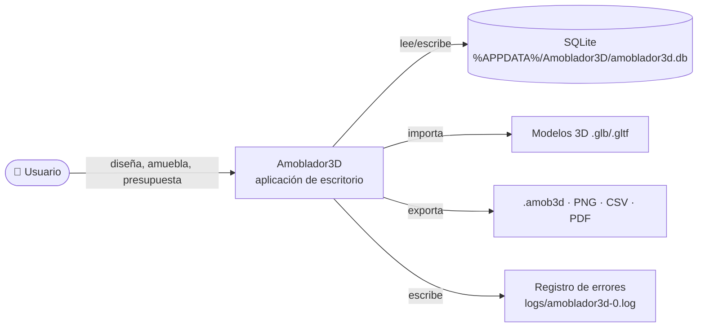
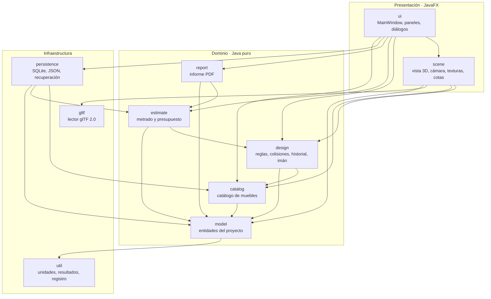
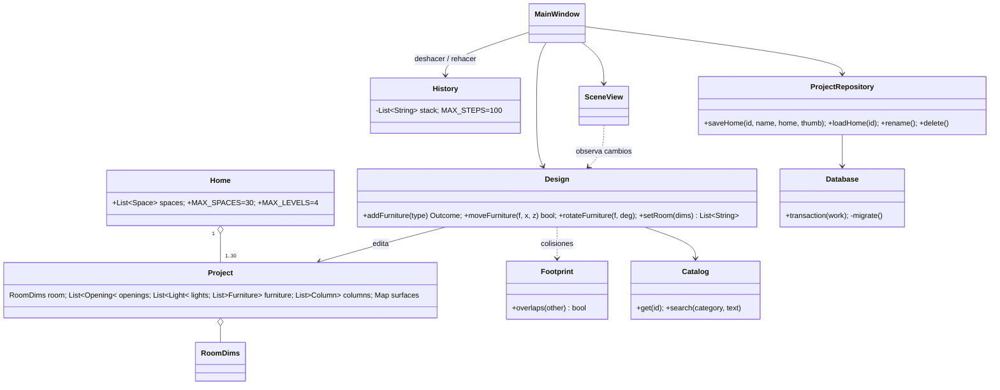
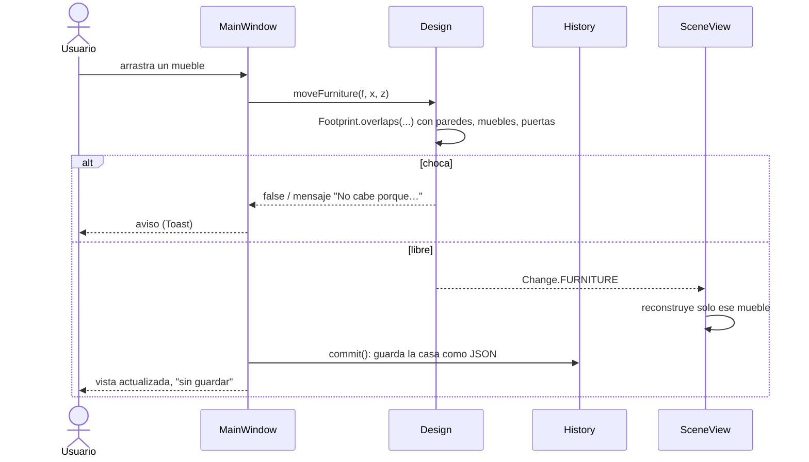
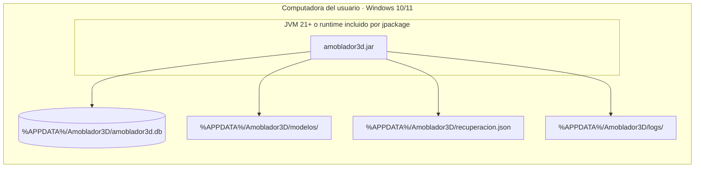

# 04 · Documento de arquitectura de software

Basado en ISO/IEC/IEEE 42010 y el modelo C4. Versión 1.0 · noviembre de 2026 · Software 2.0.0

## 1. Objetivos y restricciones de la arquitectura

<!-- Tabla: Objetivos de la arquitectura y decisiones que los cumplen -->
| Objetivo | Decisión que lo cumple |
|---|---|
| Reglas del negocio que se puedan probar sin interfaz gráfica | Los paquetes `model`, `design`, `estimate`, `persistence` y `report` **no importan JavaFX** |
| Funcionar sin internet ni servidor | SQLite embebido; todo en la carpeta del usuario |
| Datos que sobreviven a nuevas versiones | Migraciones numeradas con `PRAGMA user_version`; formato `.amob3d` compatible hacia atrás |
| Deshacer confiable | Historial por *snapshots* JSON del proyecto completo |
| Distribución simple | Un `.jar` con todas las dependencias, o un instalador con Java incluido (`jpackage`) |

**Tecnologías:** Java 21 · JavaFX 21 (controles y 3D) · SQLite (sqlite-jdbc 3.53) · Gson 2.10 ·
Apache PDFBox 3.0 · JUnit 5.13 · Maven (con Maven Wrapper) · JaCoCo · GitHub Actions.

## 2. Vista de contexto (C4 nivel 1)

<!-- Figura: Vista de contexto del sistema (C4, nivel 1) -->

## 3. Vista de contenedores y capas (C4 nivel 2)

Es una aplicación monolítica de escritorio organizada en capas. Las dependencias van de arriba
hacia abajo:

<!-- Figura: Vista de contenedores y capas (C4, nivel 2) -->

<!-- Tabla: Paquetes del código fuente y sus responsabilidades -->
| Paquete | Clases | Responsabilidad | Depende de JavaFX |
|---|---|---|---|
| `model` | 16 | Entidades: `Project`, `Home`, `RoomDims`, `Opening`, `Furniture`, `Light`, `Column`, `Surface`, `Footprint`… | No |
| `design` | 8 | `Design` (fachada con todas las reglas), `History` (deshacer), `Snapper` (imán), `Templates`, `Editors`/`Field` (formularios) | No |
| `estimate` | 4 | `Quantities` (metrado), `Estimate` (presupuesto), `PriceList`, `PurchaseSpec` | No |
| `catalog` | 5 | `Catalog`, `CatalogEntry`, `BuiltinCatalog`, `CustomDesign`, `UserModels` | No |
| `persistence` | 11 | `Database` (conexión y migraciones), repositorios, `ProjectJson`/`HomeJson`, `ProjectValidator`, `Recovery`, `AppPaths` | No |
| `report` | 2 | `ProjectReport`, `PdfLayout` (PDFBox) | No |
| `gltf` | 2 | `GltfLoader`, `ModelData` | No |
| `util` | 3 | `Units`, `Outcome`, `AppLog` | No |
| `scene` | 17 | `SceneView`, `RoomView`, `FurnitureView`, `HomeView`, `ViewCamera`, `Overlay`, `ParametricBuilder`, `SurfaceTextures`… | Sí |
| `ui` | 15 | `MainWindow`, `CatalogPanel`, `PropertiesPanel`, `FurnitureDesigner`, `EstimateDialog`, `HomePanel`, diálogos | Sí |

## 4. Vista de componentes: clases clave (C4 nivel 3)

<!-- Figura: Diagrama de clases clave (C4, nivel 3) -->

## 5. Vista de procesos: flujo de un cambio

Toda acción que cambia el proyecto sigue el mismo camino:

<!-- Figura: Diagrama de secuencia del flujo de un cambio en el diseño -->

**Hilos:** la interfaz corre en el hilo de JavaFX. La carga de modelos glTF (`ModelLibrary`) y las
miniaturas se hacen en segundo plano. El autoguardado usa un `Timeline` de 60 s en el hilo de
JavaFX. Los errores no controlados de cualquier hilo pasan por `AppLog.catchUncaught`, que los
registra y avisa al usuario.

## 6. Vista física / despliegue

<!-- Figura: Vista física y de despliegue -->

## 7. Decisiones de arquitectura (ADR)

<!-- Tabla: Registro de decisiones de arquitectura (ADR) -->
| N.° | Decisión | Alternativas | Motivo |
|---|---|---|---|
| ADR-01 | Migrar de Electron + Three.js a **Java + JavaFX** | Seguir con Electron | Curso basado en Java; menor consumo de memoria; un solo lenguaje para reglas, pruebas y UI |
| ADR-02 | **SQLite** embebido | PostgreSQL, MySQL | Sin servidor ni instalación; un archivo. Se entrega además el script PostgreSQL para consultas |
| ADR-03 | Deshacer con **snapshots JSON** de toda la casa (`History`, en `MainWindow`) | Patrón Command por operación | Más simple y robusto: cada nueva operación funciona con deshacer sin código extra. Con proyectos de KB, 100 pasos ocupan poca memoria |
| ADR-04 | Colisiones con **Teorema del Eje Separador (SAT)** sobre rectángulos orientados | Cajas alineadas a ejes | Los muebles se giran 15°; SAT es exacto para rectángulos girados |
| ADR-05 | Reglas en `Design`, **sin JavaFX** | Reglas dentro de los controladores de UI | Permite 100+ pruebas rápidas sin abrir ventanas |
| ADR-06 | Texturas **generadas por código** | Imágenes en recursos | No hay problemas de licencia, se tiñen con cualquier color y repiten sin costuras |
| ADR-07 | `Launcher` separado de `App` | Clase principal que extiende `Application` | Con `Application` como clase principal, `java -jar` exige JavaFX en el *module path* |
| ADR-08 | Casa multiambiente: el primer ambiente en las tablas de siempre y los demás como JSON en `home_space` | Normalizar todos los ambientes | Compatibilidad: una versión anterior abre al menos el primer ambiente |
| ADR-09 | Registro de errores con **java.util.logging** | Log4j, SLF4J + Logback | Cero dependencias nuevas y el módulo ya estaba incluido en el instalador |

## 8. Atributos de calidad

<!-- Tabla: Atributos de calidad y tácticas aplicadas -->
| Atributo | Táctica |
|---|---|
| Fiabilidad | Transacciones en cada guardado; `ProjectValidator` revisa datos antes de mostrarlos; autoguardado; registro de errores |
| Rendimiento | `FurnitureView` reconstruye solo lo que cambió; `Materials` comparte un material por color; caché de modelos y miniaturas |
| Mantenibilidad | Paquetes por responsabilidad; formularios generados con `Field`; 114 pruebas; cobertura mínima del 70 % en el dominio; CI |
| Usabilidad | Mensajes en español que explican la causa; atajos; plantillas; pantalla de bienvenida |
| Portabilidad | Java multiplataforma; texturas sin archivos; instalador con runtime |

## 9. Deuda técnica conocida

<!-- Tabla: Deuda técnica conocida y propuestas de mejora -->
| Tema | Detalle | Propuesta |
|---|---|---|
| `MainWindow` muy grande | ~2 440 líneas (eran ~2 600; el catálogo ya se separó en `CatalogPanel`): menús, barra, panel lateral, casa, archivo… | Seguir extrayendo: `FileActions` (abrir/guardar/exportar), `HomeController` (ambientes), `SidebarBuilder` |
| `Design` grande | ~1 200 líneas con todas las reglas | Separar `OpeningRules`, `FurnitureRules`, `ColumnRules` detrás de la misma fachada |
| Ciclo `catalog` ↔ `persistence` | `UserModels` usa `CatalogRepository` y `ProjectJson` usa `CustomDesign` | Invertir con una interfaz `ModelStore` en `catalog` |
| Cobertura de `ui` y `scene` | 0 % y 25 % (ver doc. 06) | Pruebas de interfaz con TestFX en modo *headless* (Monocle) |
