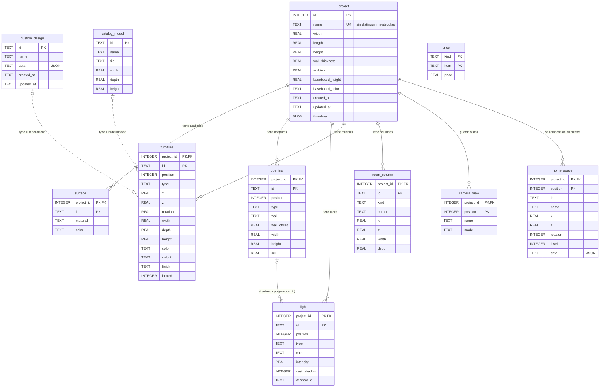

# 05 · Diseño de base de datos

Versión 1.1 · noviembre de 2026 · Esquema **v9** · Motor: SQLite 3 (embebido)

Archivo: `%APPDATA%\Amoblador3D\amoblador3d.db`. La aplicación crea y actualiza las tablas sola al
arrancar (`persistence/Database.java`). Scripts de referencia: `database/amoblador3d_sqlite.sql`
(idéntico al que usa la app, con un proyecto de ejemplo) y `database/amoblador3d_postgresql.sql`
(versión PostgreSQL con vistas de consulta).

## 1. Modelo entidad-relación

<!-- Figura: Modelo entidad-relación de la base de datos -->

Las relaciones punteadas (`custom_design`, `catalog_model` → `furniture`) son **lógicas**: el
campo `furniture.type` guarda el id del mueble del catálogo, que puede ser un paramétrico (en
código), un diseño propio o un modelo importado. No hay clave foránea porque los paramétricos no
están en la base; si el id no existe, el mueble se muestra como una caja roja y no se pierde.

## 2. Diccionario de datos

Unidades: medidas en **metros**, ángulos en **grados** (salvo `camera_view`), colores `#rrggbb`,
fechas ISO-8601 en UTC.

### `project` — un proyecto (casa); guarda las medidas del primer ambiente

<!-- Tabla: Diccionario de datos de la tabla project -->
| Columna | Tipo | Nulo | Restricción | Descripción |
|---|---|---|---|---|
| id | INTEGER | No | PK autoincremental | Identificador |
| name | TEXT | No | UNIQUE COLLATE NOCASE | Nombre visible del proyecto |
| width, length | REAL | No | 1–30 (validado en la app) | Medidas interiores del ambiente principal |
| height | REAL | No | 2–6 | Alto libre |
| wall_thickness | REAL | No | 0,05–0,50 | Grosor de muro |
| ambient | REAL | No | 0–1 | Luz ambiental |
| baseboard_height | REAL | No | DEFAULT 0,08 | Alto del zócalo (0 = sin zócalo) |
| baseboard_color | TEXT | No | DEFAULT `#f7f5f0` | Color del zócalo |
| created_at, updated_at | TEXT | No | | Fechas de creación y última modificación |
| thumbnail | BLOB | Sí | | Miniatura PNG para la lista de proyectos |

### `surface` — acabado de cada superficie

<!-- Tabla: Diccionario de datos de la tabla surface -->
| Columna | Tipo | Restricción | Descripción |
|---|---|---|---|
| project_id | INTEGER | PK, FK → project ON DELETE CASCADE | |
| id | TEXT | PK | `piso`, `techo`, `pared-norte`, `pared-sur`, `pared-este`, `pared-oeste` |
| material | TEXT | | `pintura`, `satinado`, `papel-tapiz`, `ladrillo`, `piedra`, `concreto`, `madera`, `ceramico`, `marmol`, `porcelanato`, `alfombra` |
| color | TEXT | | Color que tiñe la textura |

### `opening` — ventanas y puertas

<!-- Tabla: Diccionario de datos de la tabla opening -->
| Columna | Tipo | Restricción | Descripción |
|---|---|---|---|
| project_id | INTEGER | PK, FK | |
| id | TEXT | PK | `window-1`, `door-1`… |
| position | INTEGER | | Orden en la lista |
| type | TEXT | CHECK IN (`window`, `door`, `entry`, `double`, `sliding`, `garage`, `passage`) | Ventana o tipo de puerta |
| wall | TEXT | CHECK IN (`norte`, `sur`, `este`, `oeste`) | Pared |
| wall_offset | REAL | | Distancia desde la esquina interior al borde de la abertura |
| width, height | REAL | | Medidas del vano |
| sill | REAL | | Alféizar (0 en puertas) |

### `light` — luces

<!-- Tabla: Diccionario de datos de la tabla light -->
| Columna | Tipo | Descripción |
|---|---|---|
| project_id, id | INTEGER, TEXT | PK compuesta |
| type | TEXT | CHECK IN (`point`, `spot`, `sun`) |
| color, intensity, cast_shadow | TEXT, REAL, INTEGER | Color, intensidad (candelas o lux), proyecta sombra (0/1) |
| x, y, z | REAL | Posición (bombilla y foco) |
| target_x, target_z, angle, penumbra | REAL | Foco: punto al que apunta, apertura en grados, suavidad 0–1 |
| window_id, elevation, deviation | TEXT, REAL, REAL | Sol: ventana por la que entra, altura y desvío en grados |

### `furniture` — muebles colocados

<!-- Tabla: Diccionario de datos de la tabla furniture -->
| Columna | Tipo | Descripción |
|---|---|---|
| project_id, id | INTEGER, TEXT | PK compuesta (`cama-1`) |
| type | TEXT | Id del catálogo (paramétrico, diseño o modelo) |
| x, z | REAL | Centro de la base en el piso |
| rotation | REAL | Giro vertical en grados |
| width, depth, height | REAL | Medidas reales |
| color, color2 | TEXT | Color principal y secundario (v7) |
| finish | TEXT | `mate`, `satinado`, `brillante`, `metalico` (v7) |
| locked | INTEGER | CHECK IN (0, 1) — bloqueado (v4) |

### `room_column` — columnas, muros internos y recortes en L (v6)

<!-- Tabla: Diccionario de datos de la tabla room_column -->
| Columna | Tipo | Descripción |
|---|---|---|
| kind | TEXT | CHECK IN (`column`, `wall`, `notch`) |
| corner | TEXT | Solo en `notch`: `noroeste`, `noreste`, `suroeste`, `sureste` |
| x, z, width, depth | REAL | Rectángulo en planta (width, depth > 0) |
| material, color | TEXT | Acabado de sus caras |

### `camera_view` — vistas guardadas (v5)

<!-- Tabla: Diccionario de datos de la tabla camera_view -->
| Columna | Descripción |
|---|---|
| mode | `3d` (órbita), `plan` (planta), `walk` (recorrido) |
| x, y, z, yaw, pitch, distance | Según el modo: punto mirado o posición de los ojos; giro e inclinación en **radianes**; distancia o metros visibles |

### `home_space` — ambientes de la casa (v8, v9)

<!-- Tabla: Diccionario de datos de la tabla home_space -->
| Columna | Descripción |
|---|---|
| position | Orden; el 0 es el ambiente guardado en las tablas de arriba (`data` NULL) |
| id, name | Identificador y nombre (Sala, Dormitorio…) |
| x, z | Ubicación en el plano de la casa |
| rotation | 0, 90, 180 o 270 (horario visto desde arriba) |
| level | Piso, 0 = primero (máximo 4 pisos) |
| data | JSON del ambiente con el mismo formato que `.amob3d` |

### `custom_design`, `catalog_model`, `price` — datos globales (no dependen de un proyecto)

<!-- Tabla: Tablas globales custom_design, catalog_model y price -->
| Tabla | Contenido |
|---|---|
| `custom_design` | Muebles del Diseñador: `data` es JSON con las piezas |
| `catalog_model` | Modelos 3D importados: ruta del archivo, medidas reales (> 0) y giro |
| `price` | Precios que el usuario cambió: `kind` IN (`material`, `furniture`, `extra`), `price` ≥ 0 |

## 3. Normalización

- **1FN:** todos los campos son atómicos; las listas (aberturas, luces, muebles) están en tablas propias.
- **2FN y 3FN:** en las tablas hijas, cada atributo depende de la clave completa `(project_id, id)`.
- **Desnormalización intencional:** `home_space.data` y `custom_design.data` guardan JSON. Motivo:
  compatibilidad con versiones anteriores (ADR-08) y que un diseño es un documento que siempre se
  lee y escribe completo.

## 4. Integridad

- `PRAGMA foreign_keys = ON` en cada conexión (SQLite no las revisa si no se activa).
- `ON DELETE CASCADE`: al eliminar un proyecto se borran sus datos hijos.
- Restricciones `CHECK` para tipos enumerados y medidas positivas.
- Cada guardado es una transacción completa (`Database.transaction`): todo o nada.
- `ProjectValidator` revisa los datos al leerlos y corrige o descarta lo dañado con aviso.

## 5. Historial de migraciones

La versión se guarda en `PRAGMA user_version`. Al abrir una base antigua se aplican, en orden y
cada uno en su transacción, los pasos que faltan.

<!-- Tabla: Historial de migraciones del esquema -->
| Versión | Cambio |
|---|---|
| v1 | `project`, `opening`, `light`, `furniture`, `catalog_model` |
| v2 | `surface` (material y color de paredes y piso) |
| v3 | `price` (precios del usuario) |
| v4 | `furniture.locked` |
| v5 | `camera_view` |
| v6 | Zócalo en `project`; `room_column` |
| v7 | `furniture.color2`, `furniture.finish`; `custom_design` |
| v8 | `home_space` (casa con varios ambientes) |
| v9 | `home_space.rotation` y `level`; nuevos tipos de puerta en `opening` (se recrea la tabla para cambiar el CHECK) |

**Para agregar una migración:** añadir un paso al final de `STEPS` en `Database.java`, subir
`SCHEMA_VERSION`, actualizar los dos scripts de `database/` y la prueba
`elScriptSqliteDeEjemploLoAbreLaAplicacion`.

## 6. Vistas de consulta (solo PostgreSQL)

<!-- Tabla: Vistas de consulta disponibles en PostgreSQL -->
| Vista | Qué muestra |
|---|---|
| `project_summary` | Cada proyecto con área y cantidad de muebles, luces y aberturas |
| `project_occupancy` | Porcentaje del piso ocupado por muebles |
| `project_finishes` | Material y color de cada pared y del piso |

## Historial del documento

<!-- Tabla: Historial de cambios de este documento -->
| Versión | Fecha | Cambios | Responsable |
|---|---|---|---|
| 1.0 | 2026-11-03 | Versión inicial | Equipo del proyecto |
| 1.1 | 2026-11-06 | Título propio para el diccionario de datos de cada tabla y para el modelo entidad-relación | Equipo del proyecto |
