# 07 · Manual de usuario

**Amoblador3D 2.0.0**: diseñador de interiores 3D con medidas reales
Versión del manual 2.0 · noviembre de 2026 · Norma de referencia: ISO/IEC/IEEE 26514

---

## Contenido

1. Acerca de este manual
2. Qué es Amoblador3D
3. Requisitos e instalación
4. Primeros pasos
5. La ventana principal
6. Configurar el ambiente
7. Paredes, piso y techo
8. Muebles
9. Diseñador de muebles
10. Luces
11. Casa con varios ambientes
12. Ver y recorrer
13. Presupuesto e informe PDF
14. Guardar y compartir proyectos
15. Tutoriales paso a paso
16. Mensajes del sistema
17. Atajos de teclado
18. Preguntas frecuentes y solución de problemas
19. Glosario

---

## 1. Acerca de este manual

### 1.1 A quién va dirigido

A cualquier persona que quiera planificar la distribución y la decoración de su vivienda, sin
conocimientos de arquitectura ni de programas de diseño. Basta con saber usar el ratón y el teclado.

### 1.2 Convenciones

<!-- Tabla: Convenciones tipográficas del manual -->
| Convención | Significado | Ejemplo |
|---|---|---|
| **Negrita** | Botón, pestaña o campo de la pantalla | Pulsa **Guardar** |
| *Menú → Opción* | Ruta dentro de la barra de menús | *Archivo → Exportar imagen PNG…* |
| `Ctrl+S` | Atajo de teclado: mantén la primera tecla y pulsa la segunda | `Ctrl+Z` deshace |
| > Nota | Información útil o advertencia | |

Las medidas se escriben en **metros** con coma o punto decimal (2,5 o 2.5), salvo en el Diseñador
de muebles, donde se usan **centímetros**. Los precios están en **soles (S/)**.

## 2. Qué es Amoblador3D

Amoblador3D te ayuda a decidir cómo amoblar y decorar tu casa **antes de comprar**. Escribes las
medidas reales de tus ambientes, colocas puertas, ventanas y muebles, eliges colores y materiales, y
lo ves en 3D, en plano o caminando por dentro. Al final te dice cuánta pintura, cerámico y zócalo
necesitas y cuánto costará aproximadamente.

La aplicación **no deja que un mueble atraviese una pared, tape una puerta o se encime con otro**:
si algo no entra en la realidad, tampoco entra en Amoblador3D.

## 3. Requisitos e instalación

<!-- Tabla: Requisitos mínimos del equipo -->
| Necesitas | Mínimo |
|---|---|
| Sistema | Windows 10 u 11 (también Linux o macOS con Java) |
| Memoria | 4 GB de RAM |
| Video | Cualquier tarjeta con aceleración 3D (las integradas funcionan) |
| Espacio | 300 MB |
| Internet | No (solo la primera vez si lo ejecutas desde el código fuente) |

**Formas de abrirlo** (detalle en el Manual de instalación, documento 09):

- **Versión para Windows con Java incluido:** abre `Amoblador3D.exe` (o instala `Amoblador3D-2.0.0.exe`).
- **Con Java 21 instalado:** doble clic en `amoblador3d.jar`.
- **Desde el código fuente:** doble clic en `Ejecutar-Amoblador3D.cmd`.

## 4. Primeros pasos

Al abrir la aplicación aparece la pantalla **¿Qué quieres hacer hoy?**

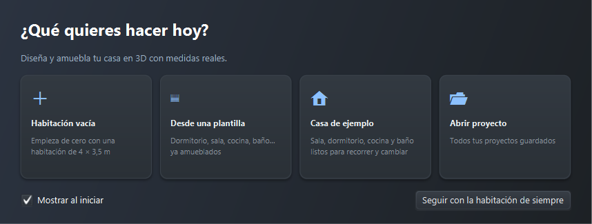

<!-- Tabla: Opciones de la pantalla de bienvenida -->
| Opción | Qué hace |
|---|---|
| **Habitación vacía** | Empieza de cero con una habitación de 4 × 3,5 m |
| **Desde una plantilla** | Dormitorio, sala, comedor, cocina, baño u oficina ya amoblados |
| **Casa de ejemplo** | Sala, dormitorio, cocina y baño listos para recorrer y cambiar |
| **Abrir proyecto** | Tus proyectos guardados, con miniatura |
| **Seguir con la habitación de siempre** | Cierra la pantalla y continúa con lo que estaba abierto |

Debajo aparecen tus **proyectos recientes**. Si no quieres ver esta pantalla al iniciar, desmarca
**Mostrar al iniciar**; puedes volver a abrirla en *Ayuda → Pantalla de bienvenida…*

> Nota: si es tu primera vez, elige **Casa de ejemplo**. Es la forma más rápida de ver todo lo que
> la aplicación puede hacer y de practicar sin miedo a equivocarte.

## 5. La ventana principal

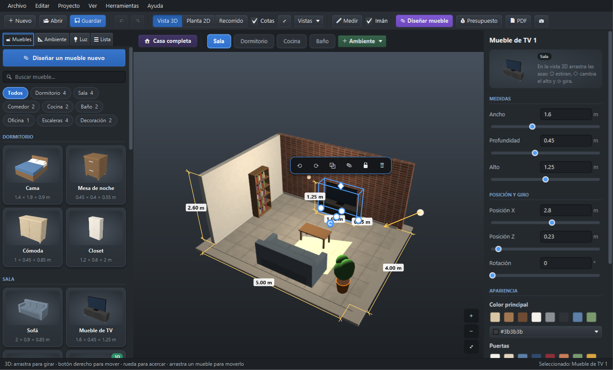

<!-- Tabla: Zonas de la ventana principal -->
| Zona | Ubicación | Para qué sirve |
|---|---|---|
| **Barra de menús** | Arriba | *Archivo, Editar, Proyecto, Ver, Herramientas, Ayuda* |
| **Barra de herramientas** | Debajo del menú | Nuevo, Abrir, Guardar, deshacer, vistas (**Vista 3D**, **Planta 2D**, **Recorrido**), **Cotas**, **Vistas**, **Medir**, **Imán**, **Diseñar mueble**, **Presupuesto**, **PDF** y captura. Pasa el ratón sobre un botón para ver qué hace y su atajo |
| **Barra de ambientes** | Sobre la vista | **Casa completa**, un botón por ambiente (Sala, Dormitorio…) y **+ Ambiente** |
| **Panel izquierdo** | Izquierda | Pestañas **Muebles** (catálogo), **Ambiente** (medidas, acabados, ventanas, puertas, columnas), **Luz** y **Lista** (todo lo que hay en el ambiente) |
| **Vista central** | Centro | El diseño en 3D, en planta o en recorrido. Los botones **+**, **−** y **⤢** de la esquina acercan, alejan y encuadran |
| **Panel de propiedades** | Derecha | Medidas, posición, giro y colores de lo que seleccionaste. Los números se aplican al pulsar Enter o al salir del campo |
| **Barra flotante** | Encima del mueble seleccionado | Girar, duplicar, bloquear, eliminar sin ir al panel |
| **Barra de estado** | Abajo | Ayuda sobre el ratón y qué está seleccionado |

**Ratón en la vista 3D:**

<!-- Tabla: Acciones con el ratón en la vista 3D -->
| Acción | Resultado |
|---|---|
| Clic | Seleccionar un mueble, pared, abertura o luz (clic en el vacío: deseleccionar) |
| Arrastrar un mueble | Moverlo sobre el piso |
| Arrastrar con el botón izquierdo en el vacío | Girar la cámara |
| Arrastrar con el botón derecho | Desplazar la cámara |
| Rueda | Acercar o alejar |

## 6. Configurar el ambiente

Pestaña **Ambiente** del panel izquierdo.

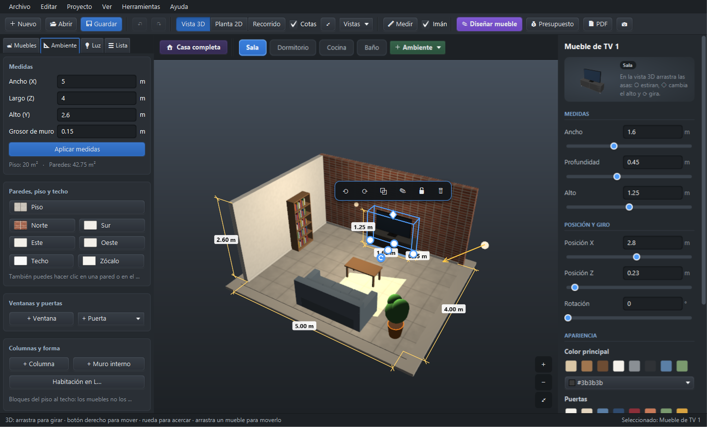

### 6.1 Medidas

<!-- Tabla: Rangos permitidos para las medidas del ambiente -->
| Campo | Rango | Nota |
|---|---|---|
| Ancho (X) y Largo (Z) | 1 a 30 m | Medidas **interiores**: mide de pared a pared por dentro |
| Alto (Y) | 2 a 6 m | Del piso al techo |
| Grosor de muro | 5 a 50 cm | Los muros crecen hacia afuera; no te quitan espacio |

Escribe los valores y pulsa **Aplicar medidas**. Debajo verás el área del piso y de las paredes.

> Nota: si achicas el ambiente y una ventana o puerta ya no entra, se elimina y la aplicación te
> avisa cuál. Puedes recuperarla con `Ctrl+Z`.

### 6.2 Ventanas y puertas

- **+ Ventana** agrega una ventana en el primer lugar libre.
- **+ Puerta ▾** permite elegir: *normal*, *principal*, *doble*, *corrediza*, *portón de cochera* o
  *vano sin puerta*. El tipo se puede cambiar luego en el panel derecho.
- Selecciona la abertura y cambia **pared**, **distancia desde la esquina**, **ancho**, **alto** y
  (en ventanas) **alféizar**.
- Dos aberturas nunca se superponen: si escribes una posición ocupada, el cambio no se aplica y se
  explica por qué.

### 6.3 Columnas y forma

- **+ Columna** (30 × 30 cm) y **+ Muro interno** (1,5 m × 12 cm): bloques del piso al techo. Los
  muebles no los atraviesan y se descuentan del piso en el presupuesto. Se mueven con las flechas o
  desde el panel derecho.
- **Habitación en L…**: elige qué esquina quitar y de qué tamaño.

## 7. Paredes, piso y techo

En **Paredes, piso y techo** (pestaña Ambiente) hay un botón por superficie: **Piso**, **Norte**,
**Sur**, **Este**, **Oeste**, **Techo** y **Zócalo**. También puedes hacer clic sobre una pared en la
vista. En el panel derecho elige:

- **Material:** pintura mate, pintura satinada, papel tapiz, ladrillo, piedra, concreto, madera,
  cerámico, mármol, porcelanato o alfombra. Solo aparecen los que tienen sentido para esa
  superficie (no hay alfombra en paredes).
- **Color:** cualquiera; tiñe la textura.
- **Aplicar a todas las paredes:** copia el material y el color a las cuatro paredes.
- **Zócalo:** alto (0 = sin zócalo) y color.

Las texturas están a **escala real**: un ladrillo mide lo que mide un ladrillo.

## 8. Muebles

### 8.1 Agregar

En la pestaña **Muebles**, filtra por categoría con los botones (**Todos**, Dormitorio, Sala, Comedor,
Cocina, Baño, Oficina, Escaleras, Decoración, Mis diseños…; el número indica cuántos hay) o escribe en
**Buscar mueble…** (no importan mayúsculas ni tildes; `Esc` borra la búsqueda). Luego:

- **Clic** en una tarjeta: el mueble se agrega en un lugar libre.
- **Arrastrar** la tarjeta a la vista: el mueble queda donde lo sueltas (o lo más cerca posible).

Si no cabe derecho, la aplicación lo prueba girado. Si no cabe de ninguna forma, te dice por qué.

### 8.2 Mover, girar y cambiar medidas

<!-- Tabla: Formas de mover, girar y redimensionar un mueble -->
| Acción | Cómo |
|---|---|
| Mover | Arrastrar con el ratón · flechas (5 cm) · `Shift` + flechas (1 cm) · campos **Posición X/Z** |
| Girar | `R` / `Shift+R` (90°) · `Q` / `E` (15°) · asa redonda delante del mueble · campo **Rotación** |
| Cambiar medidas | Asas azules en los lados y arriba del mueble seleccionado, o campos **Ancho**, **Profundidad**, **Alto** |
| Agrandar / achicar todo | Botones ±10 % del panel; *Medidas originales* para volver |
| Duplicar / eliminar | `Ctrl+D` / `Supr` |
| Bloquear | `L` o el candado de la barra flotante: un mueble bloqueado no se mueve ni se borra por accidente |

**Imán (`G`):** al arrastrar, el mueble se pega a las paredes y a los bordes o centros de otros
muebles, y aparecen líneas guía. Mantén `Alt` para soltarlo un momento.

### 8.3 Varios muebles a la vez

- `Shift` o `Ctrl` + clic: agregar o quitar de la selección.
- `Shift` + arrastrar en el vacío: rectángulo de selección.
- `Ctrl+A`: seleccionar todos.

Luego puedes moverlos, girarlos, duplicarlos o eliminarlos juntos. Si alguno chocaría, no se mueve ninguno.

### 8.4 Copiar y pegar

`Ctrl+C`, `Ctrl+X` y `Ctrl+V` funcionan también entre proyectos distintos. Si el lugar original está
ocupado, se pega en el lugar libre más cercano.

### 8.5 Colores y acabado

En **Apariencia** del panel derecho: **Color principal**, **color secundario** (frazada, cojines,
frentes de cajones, puertas, patas, encimera, grifería…) y **acabado** (mate, satinado, brillante o
metálico). Los modelos 3D importados se pueden **teñir**.

### 8.6 Importar un modelo 3D

*Archivo → Importar modelo 3D (.glb/.gltf)…* (`Ctrl+I`). Revisa el nombre, el giro (para que el frente
mire hacia adelante) y las **medidas reales**; con *Mantener proporciones* basta cambiar una.
Modelos gratuitos: Poly Haven, Sketchfab (*Downloadable*), Kenney (*Furniture Kit*). Revisa la
licencia de cada modelo. No se admiten modelos comprimidos con Draco o Meshopt.

## 9. Diseñador de muebles

Botón **Diseñar mueble** (`Ctrl+Shift+D`).

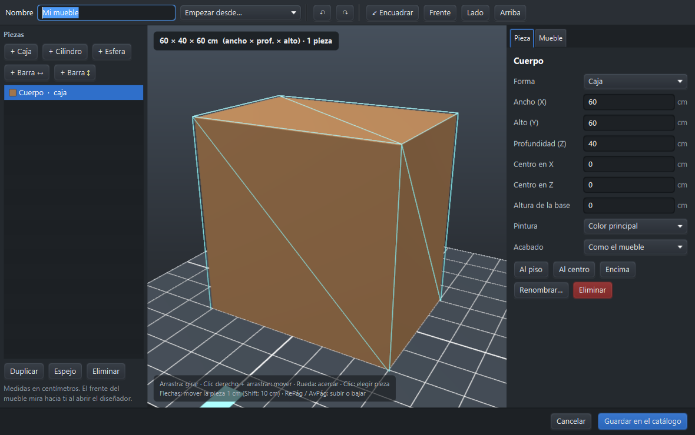

<!-- Tabla: Zonas del diseñador de muebles -->
| Zona | Uso |
|---|---|
| **Nombre** y **Empezar desde…** (arriba) | Nombre del mueble; plantilla (mesa, mesa redonda, estante, banco) o un mueble del catálogo para empezar |
| **Piezas** (izquierda) | **+ Caja**, **+ Cilindro**, **+ Esfera**, **+ Barra**; lista de piezas; **Duplicar**, **Espejo**, **Eliminar** |
| Vista 3D (centro) | Se gira con el ratón; botones **Encuadrar**, **Frente**, **Lado**, **Arriba** |
| Pestaña **Pieza** (derecha) | Forma, medidas y posición **en centímetros**, pintura (color principal, secundario o propio) y acabado; botones **Al piso**, **Al centro**, **Encima** |
| Pestaña **Mueble** | Categoría y colores del mueble completo |
| **Guardar en el catálogo** | Lo agrega al catálogo (por defecto en *Mis diseños*) |

Dentro del diseñador: `Ctrl+Z`/`Ctrl+Y` deshacer y rehacer, `Ctrl+D` duplicar pieza, `Supr` eliminar,
flechas mover. Para editar un mueble ya colocado: selecciónalo y usa *Diseñar a partir de este…*; al
guardar se reemplaza en el mismo lugar. Clic derecho sobre un diseño del catálogo para editarlo,
duplicarlo o quitarlo.

## 10. Luces

Pestaña **Luz**.

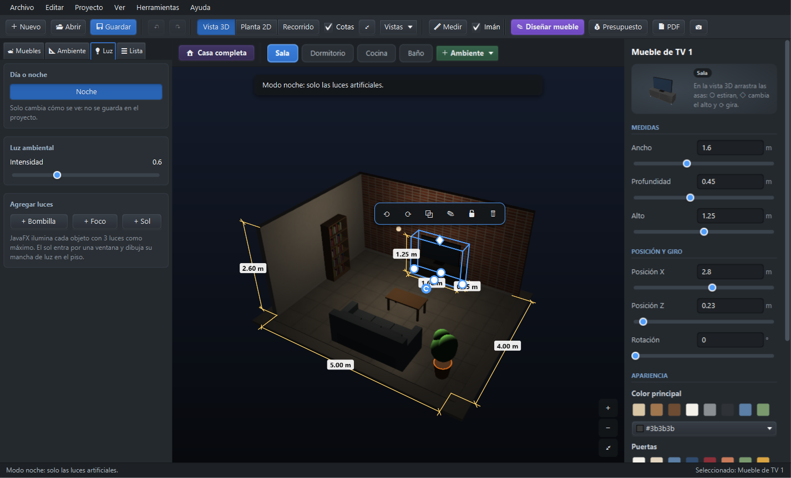

<!-- Tabla: Tipos de luz disponibles -->
| Botón | Tipo |
|---|---|
| **+ Bombilla** | Luz puntual, ilumina en todas direcciones |
| **+ Foco** | Cono de luz dirigido a un punto del piso |
| **+ Sol** | Luz solar que entra por una ventana y dibuja su mancha en el piso |

- **Luz ambiental:** claridad general.
- **Día o noche** (`N`): el modo noche quita el sol y baja la luz ambiental para ver las lámparas.
  Solo cambia cómo se ve; no se guarda en el proyecto.
- Cada objeto se ilumina con **máximo 3 luces** a la vez (límite de JavaFX).
- Si eliminas la última ventana, el sol se elimina.

## 11. Casa con varios ambientes

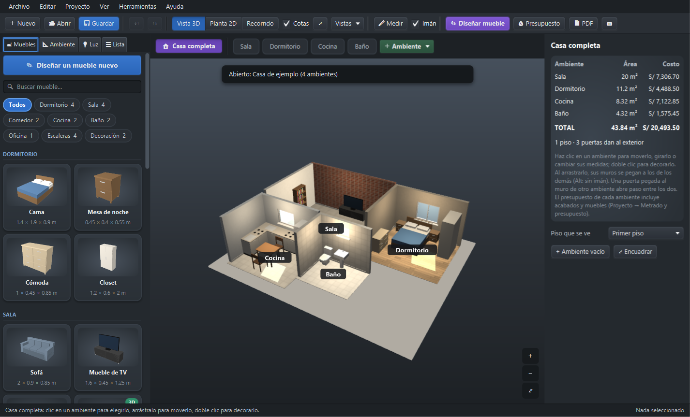

- **+ Ambiente** (barra de ambientes): vacío, desde una plantilla o copiando el actual. Se coloca
  pegado a los demás.
- **Clic** en un ambiente de la barra para decorarlo; **clic derecho** para renombrar, duplicar o eliminar.
- **Casa completa** (`Ctrl+4`): todos los ambientes juntos en 3D o en planta.
  - **Arrastra** un ambiente para ubicarlo; los muros se pegan a los de los demás y nunca se enciman
    (`Alt` para mover sin imán).
  - En el panel derecho: medidas, **girar** de 90 en 90° y **piso** (hasta 4).
  - **Piso que se ve:** en 3D se ven ese piso y los de abajo.
  - **Doble clic** en un ambiente para entrar a decorarlo.
- Si la puerta de un ambiente toca el muro de otro, ese muro se abre para pasar.
- El resumen de la derecha muestra el **área** y el **costo** de cada ambiente y de toda la casa, y
  avisa si ninguna puerta da a la calle.

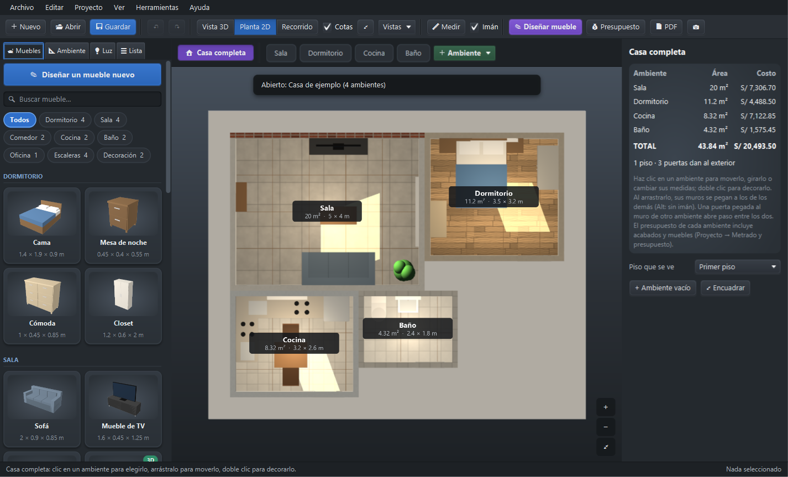

## 12. Ver y recorrer

<!-- Tabla: Modos de vista y sus atajos -->
| Vista | Atajo | Uso |
|---|---|---|
| **Vista 3D** | `Ctrl+1` | Girar alrededor del ambiente |
| **Planta 2D** | `Ctrl+2` | Vista desde arriba con cotas, como un plano |
| **Recorrido** | `Ctrl+3` | Caminar a la altura de los ojos |

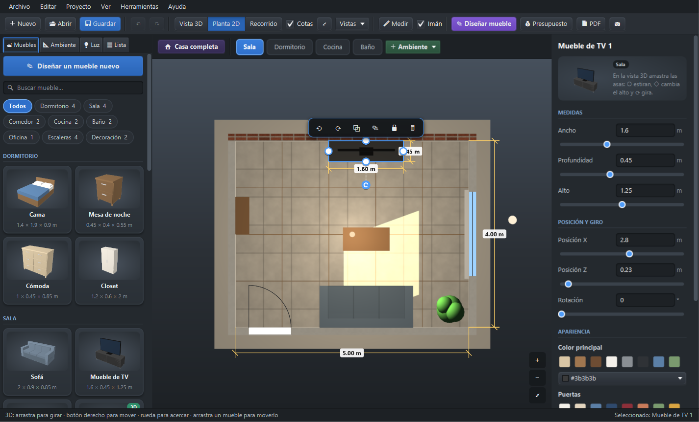

**Recorrido:** `W`/`S` o ↑/↓ avanzar y retroceder · `A`/`D` de costado · ←/→ girar · arrastrar para
mirar · `Shift` para correr. No se atraviesan paredes ni muebles. El techo se ve solo en el recorrido.

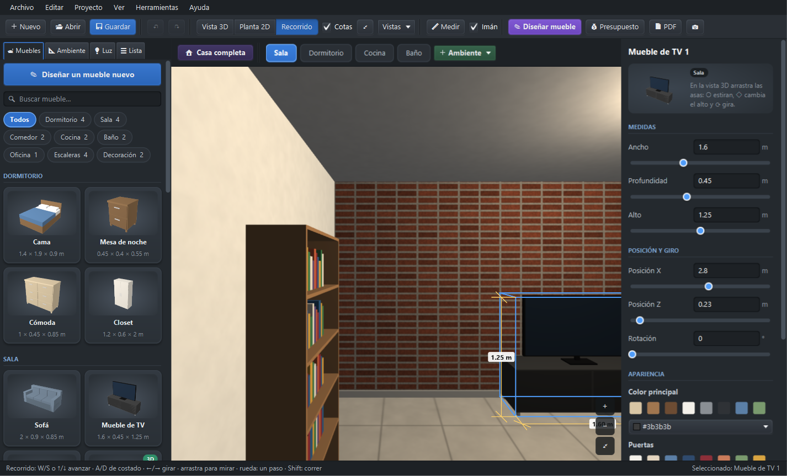

**Otras herramientas:**

- **Vistas:** guardar la vista actual con un nombre (se guarda con el proyecto), volver a ella o ver
  el ambiente desde cada puerta.
- **Cotas** (`Ctrl+M`): mostrar u ocultar las medidas.
- **Medir** (`M`): dos clics en el piso; los puntos se pegan a paredes y esquinas. `Esc` para terminar.
- **Encuadrar** (`Ctrl+0`) y **captura PNG** (`Ctrl+E`).

## 13. Presupuesto e informe PDF

**Presupuesto** (`Ctrl+P`) abre la ventana *Metrado y presupuesto*:

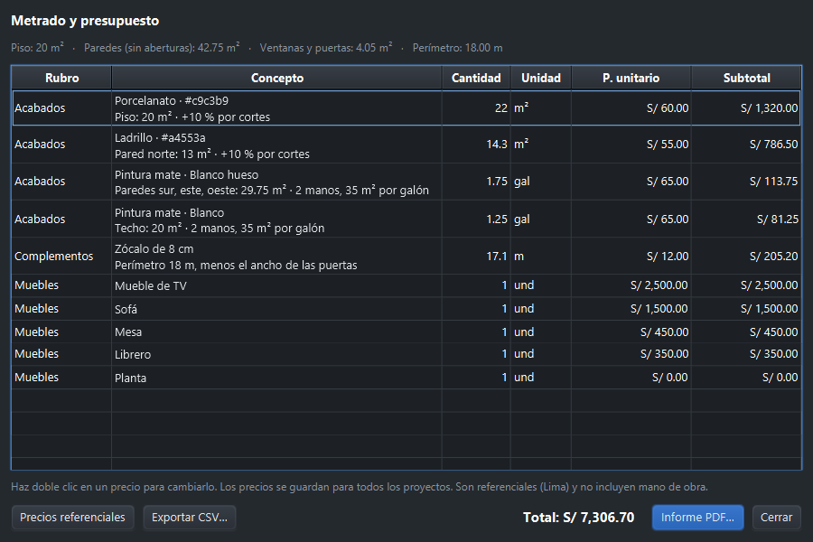

- Arriba: m² de piso, de paredes **sin** ventanas ni puertas, de ventanas y puertas, y perímetro.
- **Acabados:** pintura en galones para 2 manos (un galón cubre unos 35 m² por mano), redondeado al
  cuarto de galón; papel tapiz en rollos; pisos y enchapes en m² con **10 % de desperdicio**.
- **Complementos:** zócalo en metros (sin contar el ancho de las puertas).
- **Muebles** con su precio.

Los precios son **referenciales en soles (Lima, 2026)** y no incluyen mano de obra. Cámbialos con
**doble clic** sobre el precio: se guardan para todos tus proyectos. **Precios referenciales** vuelve a
los originales y **Exportar CSV…** abre el presupuesto en Excel.

**PDF** (`Ctrl+Shift+P`) o **Informe PDF…** dentro del presupuesto: datos del ambiente, planta con
cotas, vista 3D, ventanas y puertas, muebles y presupuesto. Listo para imprimir o enviar.

## 14. Guardar y compartir proyectos

<!-- Tabla: Formas de guardar y compartir proyectos -->
| Acción | Dónde | Nota |
|---|---|---|
| Guardar / Guardar como | `Ctrl+S` / *Archivo* | En la base de datos local, con miniatura |
| Abrir | `Ctrl+O` | Lista con miniaturas; renombrar o eliminar desde ahí |
| Nuevo desde plantilla | `Ctrl+Shift+N` | Ver figura siguiente |
| Exportar `.amob3d` | *Archivo* | Para pasar el proyecto a otra PC. Incluye tus diseños de muebles |
| Importar `.amob3d` | *Archivo* | Si algo del archivo está dañado, se corrige y se avisa |
| Deshacer / rehacer | `Ctrl+Z` / `Ctrl+Y` | Hasta 100 pasos, incluidos los cambios de la casa |

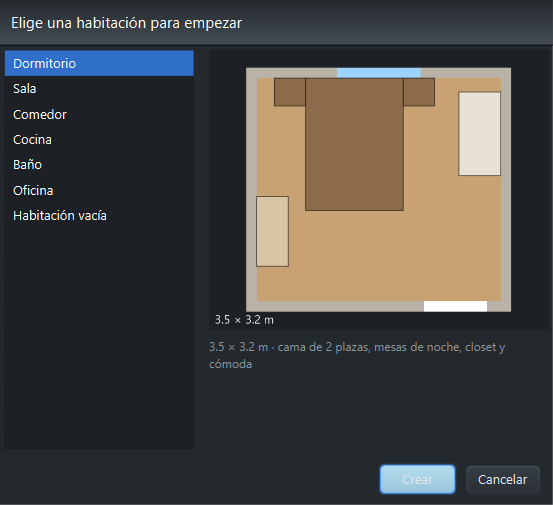

**Autoguardado:** mientras hay cambios sin guardar, se hace una copia cada minuto. Si la aplicación
se cierra de golpe (corte de luz, error), al volver a abrirla te ofrece **recuperar** el trabajo.

## 15. Tutoriales paso a paso

### 15.1 Amoblar un dormitorio de 3,5 × 3 m

1. *Archivo → Nuevo proyecto* (`Ctrl+N`).
2. Pestaña **Ambiente**: Ancho `3.5`, Largo `3`, Alto `2.5`; pulsa **Aplicar medidas**.
3. **+ Puerta ▾ → normal**. En el panel derecho elige la pared **Sur** y una distancia de `0.3` m
   desde la esquina.
4. **+ Ventana**. Elige la pared **Norte**, ancho `1.2` m.
5. Pestaña **Muebles**, categoría **Dormitorio**: clic en **Cama**, **Mesa de noche** (dos veces) y **Closet**.
6. Arrastra la cama contra la pared norte (el imán la pega) y las mesas de noche a sus lados.
7. Selecciona el closet y gíralo con `R` hasta que su frente mire al centro; llévalo a una pared libre.
8. Botón **Norte** de *Paredes, piso y techo*: material **Papel tapiz** y el color que prefieras.
9. `Ctrl+3` para recorrerlo y comprobar que se puede abrir la puerta y caminar.
10. `Ctrl+S`, nombre *Mi dormitorio*.

**Resultado:** un dormitorio sin muebles encimados ni puertas bloqueadas, guardado con miniatura.

### 15.2 Armar una casa de dos pisos

1. Desde la pantalla de bienvenida elige **Casa de ejemplo** (o abre tu proyecto).
2. **+ Ambiente → desde una plantilla → Dormitorio**.
3. `Ctrl+4` (**Casa completa**). Selecciona el ambiente nuevo y, en el panel derecho, cambia **Piso** a
   *Segundo piso*.
4. Arrastra el dormitorio hasta que quede encima de la sala. En el piso de arriba no choca con los de abajo.
5. Agrega una **Escalera en L** desde la categoría **Escaleras** en la sala: llega sola al techo.
6. En **Piso que se ve**, alterna entre el primer y el segundo piso para revisar ambos.

### 15.3 Calcular el presupuesto de pintar la sala

1. Abre la sala y selecciona cada pared: material **Pintura mate**, color *Blanco hueso*.
2. `Ctrl+P`. La línea *Pintura mate* indica los m² (sin ventanas ni puertas) y los galones para 2 manos.
3. Doble clic en el **P. unitario** de la pintura y escribe el precio de tu ferretería: el total se recalcula.
4. **Exportar CSV…** para llevarlo a Excel o **Informe PDF…** para imprimirlo.

## 16. Mensajes del sistema

Los avisos aparecen unos segundos sobre la vista (o en una ventana si necesitan respuesta).

<!-- Tabla: Mensajes del sistema y acciones recomendadas -->
| Mensaje | Qué significa | Qué hacer |
|---|---|---|
| *No hay espacio libre para …* | El mueble no entra en ningún lugar libre del ambiente | Achica o mueve otros muebles, o agranda el ambiente |
| *… chocaría con …* / el mueble no se mueve | En el lugar de destino hay una pared, columna, mueble o el paso de una puerta | Muévelo a otro lugar o suelta el imán con `Alt` |
| *… ya no cabía y se eliminó* | Achicaste el ambiente y una ventana o puerta quedó fuera | `Ctrl+Z` si fue un error |
| *… está bloqueado: no se puede mover* | Tiene el candado puesto | Pulsa `L` para desbloquearlo |
| *Ya existe un proyecto llamado …* | Los nombres no se repiten (sin importar mayúsculas) | Usa otro nombre |
| *¿Guardar los cambios de …?* | Vas a cerrar o abrir otro proyecto con cambios sin guardar | **Guardar**, **No guardar** o **Cancelar** |
| *¿Quieres recuperarlos?* (al abrir) | La última vez la aplicación se cerró de golpe | **Recuperar** para volver a lo que tenías |
| *El archivo no es un modelo glTF válido* | El archivo está dañado o no es un modelo 3D | Descárgalo de nuevo o prueba otro |
| *No se admiten modelos comprimidos con Draco/Meshopt* | El modelo usa una compresión que la aplicación no lee | Descarga la versión sin comprimir |
| *La base de datos fue creada con una versión más nueva* | Abriste los datos con una versión anterior de la aplicación | Instala la versión más reciente |
| *Algo salió mal* | Ocurrió un error inesperado (quedó en el registro) | Guarda tu trabajo y envía el registro al soporte (sección 18) |

## 17. Atajos de teclado

Pulsa `F1` dentro de la aplicación para verlos todos.

<!-- Tabla: Atajos de teclado -->
| Tecla | Acción |
|---|---|
| `Ctrl+N` / `Ctrl+O` / `Ctrl+S` | Nuevo / Abrir / Guardar |
| `Ctrl+Shift+N` | Nuevo desde plantilla |
| `Ctrl+Z` / `Ctrl+Y` | Deshacer / Rehacer |
| Flechas (`Shift`: más fino) | Mover el mueble 5 cm (1 cm) |
| `R` / `Shift+R` · `Q` / `E` | Girar 90° · girar 15° |
| `Supr` / `Ctrl+D` | Eliminar / Duplicar |
| `Ctrl+C` / `Ctrl+X` / `Ctrl+V` | Copiar / Cortar / Pegar |
| `Ctrl+A` | Seleccionar todos los muebles |
| `L` / `G` | Bloquear / Imán |
| `Ctrl+1` / `2` / `3` / `4` | Vista 3D / Planta / Recorrido / Casa completa |
| `N` | Modo noche |
| `Ctrl+P` / `Ctrl+Shift+P` | Presupuesto / Informe PDF |
| `Ctrl+Shift+D` | Diseñador de muebles |
| `Ctrl+I` | Importar modelo 3D |
| `Ctrl+M` / `Ctrl+0` / `Ctrl+E` | Cotas / Encuadrar / Captura PNG |
| `M` | Medir distancias (`Esc` para terminar) |
| `F1` | Todos los atajos |

## 18. Preguntas frecuentes y solución de problemas

<!-- Tabla: Problemas frecuentes y su solución -->
| Problema | Solución |
|---|---|
| No puedo mover un mueble | Puede estar **bloqueado** (pulsa `L`) o chocaría con algo en ese lugar |
| El mueble no se pega donde quiero | Mantén `Alt` mientras arrastras, o desactiva el imán con `G` |
| No veo el techo | Solo se dibuja en el **Recorrido** (`Ctrl+3`), para que puedas ver el interior desde arriba |
| La vista 3D se ve negra o lenta | Actualiza el controlador de la tarjeta de video |
| *No se pudo abrir la base de datos* | Hay otra copia de Amoblador3D abierta, o el archivo `.db` está abierto en otro programa. Ciérralos |
| Un modelo importado se ve gigante o diminuto | Corrige sus medidas reales al importarlo, o en el panel derecho |
| Perdí mi trabajo por un corte de luz | Abre la aplicación: te ofrecerá recuperar la última copia (se hace cada minuto) |
| Apareció *Algo salió mal* | Guarda tu trabajo. Abre *Ayuda → Abrir registro de errores* y envía el archivo `amoblador3d-0.log` al equipo de soporte |
| ¿Dónde están mis datos? | En `%APPDATA%\Amoblador3D` (escribe eso en la barra del Explorador de Windows) |
| ¿Cómo hago copia de seguridad? | Con la aplicación cerrada, copia la carpeta `%APPDATA%\Amoblador3D`; o exporta cada proyecto como `.amob3d` |

## 19. Glosario

<!-- Tabla: Glosario del manual de usuario -->
| Término | Significado |
|---|---|
| Alféizar | Altura desde el piso hasta el borde inferior de la ventana |
| Ambiente | Cada habitación de la casa |
| Cota | Medida dibujada en el plano |
| Imán | Ayuda que pega el mueble a paredes y a otros muebles al arrastrarlo |
| Metrado | Cálculo de cantidades: m² de pared, piso, metros de zócalo |
| Planta | Vista desde arriba, como un plano |
| Vano | Abertura en la pared sin puerta |
| Zócalo | Franja al pie de las paredes |
