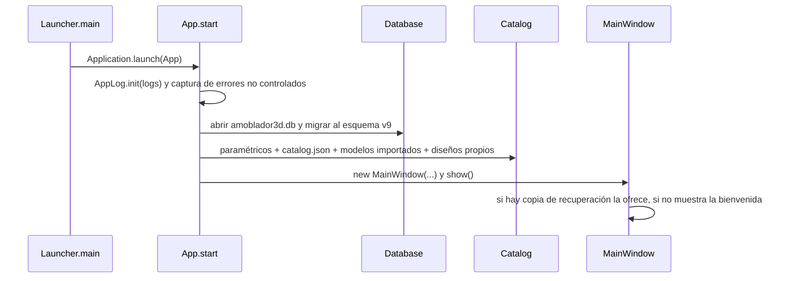

# 08 · Manual técnico del desarrollador

Versión 2.0 · noviembre de 2026 · Software 2.0.0

Para quien va a compilar, mantener o extender Amoblador3D. La arquitectura completa está en el
documento 04 y la base de datos en el 05; aquí se explica **cómo trabajar con el código**.

## 1. Entorno de desarrollo

<!-- Tabla: Herramientas del entorno de desarrollo -->
| Herramienta | Versión | Nota |
|---|---|---|
| JDK | 21 o superior | Temurin recomendado. El build falla con un mensaje claro si es menor (maven-enforcer) |
| Maven | No hace falta | El proyecto trae Maven Wrapper (`mvnw` / `mvnw.cmd`) |
| IDE | IntelliJ IDEA, VS Code o NetBeans | Abrir la carpeta como proyecto Maven |
| Git | 2.x | Repositorio: `https://github.com/alex123floresc-sketch/amoblador3d` |
| Node.js (opcional) | 18 o superior | Solo para regenerar los documentos Word (sección 12) |

**Configurar IntelliJ IDEA:**

1. *File → Open* y elige la carpeta del proyecto (la reconoce como Maven).
2. *File → Project Structure → SDK*: JDK 21 o superior.
3. Crea una configuración *Application* con clase principal `pe.edu.unaj.amoblador3d.Launcher` y,
   en *VM options*: `--enable-native-access=ALL-UNNAMED -Damoblador.home=C:\temp\amob-dev`
   (así trabajas con una carpeta de datos de prueba y no con la tuya).

## 2. Comandos

```powershell
.\mvnw.cmd javafx:run     # ejecutar la aplicación
.\mvnw.cmd test           # pruebas
.\mvnw.cmd verify         # pruebas + cobertura (target\site\jacoco\index.html); falla si el dominio baja del 70 %
.\mvnw.cmd package        # target\amoblador3d.jar con todas las dependencias
.\mvnw.cmd test -Dtest=DesignTest                      # una sola clase de prueba
.\mvnw.cmd test -Dtest=DesignTest#siDerechoNoCabeSePruebaGirado   # un solo caso
.\packaging\crear-instalador.ps1   # versión para Windows con Java incluido
```

<!-- Tabla: Propiedades de la JVM para configurar la ejecución -->
| Propiedad de la JVM | Para qué |
|---|---|
| `-Damoblador.home=C:\temp\prueba` | Usar otra carpeta de datos (pruebas, USB, capturas) |
| `--enable-native-access=ALL-UNNAMED` | Evita avisos de SQLite en Java 22+ (ya configurado en `pom.xml`, `javafx:run` y el manifiesto del `.jar`) |

## 3. Estructura del repositorio

```
amoblador3d/
├── .github/workflows/ci.yml     integración continua (GitHub Actions, Windows)
├── database/                    scripts SQL: SQLite (el de la app) y PostgreSQL
├── documentacion/               documentación (Markdown), capturas/, doc 2/ (Word), herramientas/
├── packaging/                   instalador para Windows (jpackage)
├── src/main/java/pe/edu/unaj/amoblador3d/
│   ├── Launcher, App            arranque
│   ├── model/                   entidades (sin JavaFX)
│   ├── design/                  reglas, historial, imán, plantillas, formularios
│   ├── estimate/                metrado y presupuesto
│   ├── catalog/                 catálogo de muebles
│   ├── persistence/             SQLite, JSON, recuperación, rutas
│   ├── report/                  informe PDF
│   ├── gltf/                    lector glTF 2.0
│   ├── scene/                   vista 3D (JavaFX)
│   ├── ui/                      ventana, paneles y diálogos (JavaFX)
│   └── util/                    unidades, Outcome, registro de errores
├── src/main/resources/          catalog.json, modelos .glb, CSS, ícono
├── src/test/java/               114 pruebas JUnit 5 y la herramienta de capturas
├── pom.xml                      dependencias y plugins
└── Ejecutar-Amoblador3D.cmd     abrir con doble clic
```

## 4. Cómo funciona por dentro

### 4.1 Arranque

<!-- Figura: Diagrama de secuencia del arranque de la aplicación -->


`Launcher` existe porque, si la clase principal extiende `Application`, `java -jar` exige JavaFX en el
*module path*. Nunca cambies la clase principal a `App`.

### 4.2 Ciclo de una edición

Toda acción del usuario que cambia el proyecto sigue el mismo camino:

1. **`MainWindow`** (o un panel) recibe el clic o la tecla y llama a un método de **`Design`**
   (`addFurniture`, `moveFurniture`, `rotateFurniture`, `setRoom`…).
2. **`Design`** valida con las reglas (huellas con `Footprint.overlaps`, límites de `RoomDims`,
   márgenes de aberturas) y devuelve `Outcome<T>` (valor o mensaje de error), un `String` con el
   error o `null` si todo salió bien, o un `boolean`.
3. Si tuvo éxito, `Design` avisa a sus suscriptores (`addListener`) qué cambió: `ROOM`, `SURFACES`,
   `LIGHTS`, `FURNITURE` o `VIEWS`. La vista 3D reconstruye **solo** esa parte.
4. **`MainWindow`** llama a `history.commit()`: el historial guarda la casa completa como JSON
   (`HomeJson.write`) para poder deshacer, y la ventana se marca "sin guardar".
5. Si falló, `MainWindow` muestra el mensaje en un aviso flotante (`Toast`).

```java
// Patrón usado en MainWindow (simplificado)
private <T> void handle(Outcome<T> outcome, Consumer<T> onOk) {
    if (outcome.failed()) {
        notify(outcome.error(), Toast.Kind.ERROR);   // "No hay espacio libre para la cama"
        return;
    }
    history.commit();                                 // paso para deshacer
    onOk.accept(outcome.value());                     // por ejemplo, seleccionar el mueble nuevo
}
```

### 4.3 Guardado, archivos y autoguardado

<!-- Tabla: Mecanismos de guardado, archivos y autoguardado -->
| Mecanismo | Clase | Detalle |
|---|---|---|
| Base de datos | `ProjectRepository.saveHome / loadHome` | Todo en una transacción (`Database.transaction`). El primer ambiente va en tablas; los demás, como JSON en `home_space` |
| Archivo `.amob3d` | `HomeJson.write / read`, `ProjectJson` | JSON legible; incluye los diseños propios usados. El primer ambiente queda en la raíz para que versiones anteriores lo abran |
| Validación al leer | `ProjectValidator.validate` | Revisa todo **antes** de mostrar; corrige o descarta lo dañado y avisa |
| Autoguardado | `Recovery` | Cada 60 s, si hay cambios, escribe `recuperacion.json`; se borra al guardar o cerrar bien |
| Deshacer | `History` | Pila de hasta 100 copias JSON de la casa |

### 4.4 Vista 3D

`SceneView` une `RoomView` (piso, paredes con huecos, zócalo, techo), `FurnitureView` (muebles),
`LightView` (luces) y `Overlay` (cotas y contornos dibujados en 2D encima). `ViewCamera` maneja las
tres cámaras (órbita, planta y recorrido). Las texturas se dibujan por código en `SurfaceTextures`
y se aplican a escala real con `Meshes`. `Materials` comparte un material por color para no crear
miles de objetos iguales.

## 5. Convenciones de código

- **Idioma:** comentarios, mensajes y nombres de pruebas en español; nombres de clases y métodos en inglés.
- **Unidades:** todo en **metros** dentro del código; la interfaz muestra cm cuando conviene (`Units`).
- **Coordenadas:** origen en la esquina interior **noroeste** a nivel del piso; X al este, Z al sur, Y arriba.
- **Reglas fuera de la UI:** toda validación va en `design/Design.java` (o en `model`), nunca en
  `ui/`. La interfaz solo llama y muestra el resultado.
- **Cada cambio pasa por `Design`** y, si tuvo éxito, la ventana hace `history.commit()`: así se puede
  deshacer y se marca "sin guardar". No modifiques las listas del proyecto directamente desde la UI.
- **Mensajes al usuario:** explican el motivo en lenguaje sencillo ("No hay espacio libre para…").
- **Errores inesperados:** regístralos con `AppLog` (sección 9); nunca `printStackTrace()`.
- **SQL:** siempre `PreparedStatement` con parámetros; nunca concatenar datos del usuario.
- **Pruebas:** nombres que se leen como una frase (`unaPuertaNoPuedeQuedarBloqueadaPorUnMueble`).
- **Comentarios:** explican el *por qué* (por ejemplo, por qué existe `Launcher`), no lo que el código ya dice.

## 6. Cómo extender

### 6.1 Agregar un mueble paramétrico

1. Crea su método en `scene/ParametricBuilder.java` y regístralo en `build`.
2. Declara sus medidas por defecto y su categoría en `catalog/Catalog.java`.
3. Agrega su precio referencial en `estimate/PriceList.java`.
4. Ejecuta las pruebas: `ParametricBuilderTest` verifica que ocupe exactamente
   `x ∈ [-ancho/2, ancho/2]`, `z ∈ [-prof/2, prof/2]`, `y ∈ [0, alto]`, con el frente hacia +Z;
   `CatalogTest` verifica que tenga categoría y precio.

### 6.2 Incluir un modelo 3D en la aplicación

1. Copia el `.glb` en `src/main/resources/assets/models/`.
2. Agrega una entrada en `src/main/resources/assets/catalog.json`:
   ```json
   { "id": "mi-sillon", "name": "Sillón", "file": "models/mi-sillon.glb",
     "width": 0.9, "depth": 0.85, "height": 0.95, "rotation": 0, "category": "Sala" }
   ```
3. Recompila.

### 6.3 Agregar un material de superficie

1. Agrega el valor al enum `model/SurfaceMaterial.java` (id, nombre, color sugerido y dónde se usa).
2. Dibuja su textura en `scene/SurfaceTextures.java`.
3. Define cómo se compra en `estimate/PurchaseSpec.java` y su precio en `PriceList.java`.
4. Si el script PostgreSQL tiene un CHECK de materiales, actualízalo.

### 6.4 Agregar una regla de validación

1. Implementa la comprobación en `Design` (o en una clase de `model` si es geometría pura) y
   devuelve un mensaje que explique el motivo.
2. Si un campo del panel tiene límites, usa **las mismas constantes** en `design/Editors.java`
   (antes, el panel permitía valores que luego `Design` rechazaba).
3. Escribe primero la prueba que falla y luego el código (sección 7).

### 6.5 Cambiar la base de datos

1. Agrega un paso al final de `STEPS` en `persistence/Database.java` y sube `SCHEMA_VERSION`.
2. Actualiza `ProjectRepository` (lectura y escritura).
3. Actualiza los dos scripts de `database/` y el documento 05.
4. Las pruebas `unaBaseDeLaVersionAnteriorSeActualiza` y `elScriptSqliteDeEjemploLoAbreLaAplicacion`
   comprueban que nada se rompa.

### 6.6 Agregar un campo al panel de propiedades

Agrega un `Field` en `design/Editors.java` para el tipo de entidad, con los mismos límites que usa
`Design`. `PropertiesPanel` dibuja el formulario solo.

## 7. Cómo escribir pruebas

Las reglas se prueban sin abrir ventanas: basta crear un `Design` con un `Catalog`.

```java
class MiReglaTest {
    private Design design;

    @BeforeEach
    void setUp() {
        design = new Design(new Catalog());   // habitación por defecto: ventana, puerta, bombilla y sol
    }

    @Test
    void unaSillaNoPuedeQuedarEnElPasoDeLaPuerta() {
        Opening door = design.openings().stream()
                .filter(o -> o.type == OpeningType.DOOR).findFirst().orElseThrow();
        Footprint paso = design.doorZone(door);
        Furniture silla = design.addFurniture("silla").value();

        // editor(f) es un ayudante de DesignTest: devuelve los campos del panel de propiedades
        String error = editor(silla).set("x", paso.x());       // como si el usuario lo escribiera
        if (error == null) error = editor(silla).set("z", paso.z());

        assertNotNull(error, "la silla no debería poder ponerse en el paso de la puerta");
    }
}
```

<!-- Tabla: Guía para escribir pruebas según lo que se prueba -->
| Qué probar | Cómo |
|---|---|
| Reglas | `new Design(new Catalog())` y sus métodos |
| Base de datos | `new Database(dir.resolve("x.db"))` con `@TempDir`: una base real y vacía por prueba |
| Archivos `.amob3d` | `HomeJson.write` y `HomeJson.read` (ida y vuelta) |
| Modelos 3D | Armar el glTF en memoria (ver `GltfLoaderTest`) |
| Geometría de muebles | Nodos JavaFX sin ventana (ver `ParametricBuilderTest`) |

**Regla del proyecto:** todo defecto corregido lleva una prueba que lo reproduce, y la cobertura de los
paquetes de dominio no puede bajar del 70 % (lo revisa `mvnw verify`).

## 8. Depuración

<!-- Tabla: Situaciones de depuración y qué hacer -->
| Situación | Qué hacer |
|---|---|
| Quiero ver qué pasó en la PC de un usuario | Pídele *Ayuda → Abrir registro de errores* y el archivo `amoblador3d-0.log` |
| Quiero probar sin tocar mis proyectos | Ejecuta con `-Damoblador.home=C:\temp\prueba` |
| Un proyecto no abre | Exporta el `.amob3d` (o copia la fila de la base) y reprodúcelo en una prueba con `HomeJson.read` |
| La base parece dañada | Ábrela con DB Browser for SQLite (con la aplicación cerrada); `PRAGMA user_version` indica el esquema |
| La vista 3D no se actualiza | Revisa que la operación de `Design` notifique el `Change` correcto |
| Deshacer no funciona para una acción nueva | Falta `history.commit()` después de la operación en `MainWindow` |

## 9. Registro de errores

La aplicación registra lo que pasa con `java.util.logging` (clase `util/AppLog.java`):

<!-- Tabla: Ubicación del registro de errores -->
| Qué | Dónde |
|---|---|
| Archivo | `%APPDATA%\Amoblador3D\logs\amoblador3d-0.log` (5 archivos de 1 MB que rotan) |
| Contenido | Inicio (versión, Java, sistema), avisos de carga, errores mostrados al usuario, fallos del autoguardado y errores no controlados con su traza |
| Acceso del usuario | *Ayuda → Abrir registro de errores* |

```java
private static final Logger LOG = AppLog.of(MiClase.class);
LOG.warning("No se pudo leer el modelo " + archivo);
LOG.log(Level.SEVERE, "Falló el guardado", e);
```

Todo `Dialogs.error(...)` queda registrado automáticamente, y cualquier excepción no atrapada en
cualquier hilo se registra y muestra el aviso "Algo salió mal".

## 10. Integración continua y calidad

`.github/workflows/ci.yml` se ejecuta en cada *push* a `main` o a ramas `fase-*` y en cada *pull
request*: instala Temurin 21 en Windows, ejecuta `mvnw verify` y publica como artefactos los
resultados de las pruebas, el informe de cobertura y el `amoblador3d.jar`.

<!-- Tabla: Controles de integración continua y calidad -->
| Control | Herramienta | Falla si… |
|---|---|---|
| Versión de Java y Maven | maven-enforcer | JDK menor que 21 o Maven menor que 3.6.3 |
| Pruebas | Surefire + JUnit 5 | Alguna prueba falla |
| Cobertura | JaCoCo (`cobertura-minima`) | Un paquete de dominio o datos baja del 70 % |

## 11. Publicar una versión

1. Sube la versión en `pom.xml` (`<version>`), siguiendo versionado semántico: cambio incompatible →
   mayor; función nueva → menor; corrección → parche.
2. Actualiza el historial de versiones (documento 12) y, si cambió la base, el documento 05.
3. `.\mvnw.cmd verify` debe terminar en `BUILD SUCCESS`.
4. `.\packaging\crear-instalador.ps1` para el instalador de Windows.
5. Haz las pruebas manuales del documento 06 (sección 3) con el instalador.
6. Integra la rama de la fase en `main` con un *pull request* y crea una etiqueta: `git tag v2.0.0`.
7. Publica el instalador y el `.jar` en *GitHub → Releases*.

## 12. Herramientas de documentación

<!-- Tabla: Herramientas para generar la documentación -->
| Herramienta | Ubicación | Qué hace |
|---|---|---|
| Capturas de pantalla | `src/test/java/.../ui/Capturas.java` | Abre la aplicación con una carpeta temporal, recorre sus pantallas con los menús y guarda PNG en `documentacion/capturas` |
| Documentos Word | `documentacion/herramientas/generar.js` | Convierte los Markdown en `.docx` con formato APA 7 (carpeta `doc 2`) y dibuja los diagramas Mermaid |

Regenerar las capturas (PowerShell, desde la raíz del proyecto):

```powershell
.\mvnw.cmd -q test-compile dependency:build-classpath "-Dmdep.outputFile=target/cp.txt"
$cp = "target\classes;target\test-classes;" + (Get-Content target\cp.txt -Raw).Trim()
java --enable-native-access=ALL-UNNAMED "-Damoblador.home=$env:TEMP\amob-capturas" -cp $cp `
     'pe.edu.unaj.amoblador3d.ui.Capturas$Main' documentacion\capturas
```

Regenerar los Word:

```powershell
cd documentacion\herramientas
npm install        # solo la primera vez
npm run generar
```

## 13. Dependencias

<!-- Tabla: Dependencias del proyecto, versión y licencia -->
| Librería | Versión | Licencia | Uso |
|---|---|---|---|
| OpenJFX (javafx-controls) | 21.0.4 | GPL v2 + Classpath Exception | Interfaz y 3D |
| sqlite-jdbc (Xerial) | 3.53.4.0 | Apache 2.0 | Base de datos |
| Gson | 2.10.1 | Apache 2.0 | JSON (`.amob3d`, catálogo, glTF) |
| Apache PDFBox | 3.0.5 | Apache 2.0 | Informe PDF |
| JUnit Jupiter | 5.13.4 | EPL 2.0 | Pruebas |
| JaCoCo | 0.8.14 | EPL 2.0 | Cobertura (solo al construir) |

## 14. Problemas conocidos para el desarrollador

<!-- Tabla: Problemas conocidos para el desarrollador -->
| Síntoma | Causa y solución |
|---|---|
| `java -jar` dice que faltan componentes de JavaFX | Se ejecutó `App` en vez de `Launcher`. Usa siempre `Launcher` como clase principal |
| Avisos `WARNING: A restricted method… System::load` | Java 22+ sin `--enable-native-access`. Ya está configurado; si ejecutas desde el IDE, agrégalo a las opciones de la VM |
| `showAndWait is not allowed during animation or layout processing` | Se abrió un diálogo modal dentro de una animación; envuélvelo en `Platform.runLater` |
| Avisos `LF will be replaced by CRLF` | `.gitattributes` normaliza los finales de línea; son inofensivos |
| El `.jar` no abre en otro sistema operativo | JavaFX trae partes nativas por sistema; compila en el mismo sistema donde se usará |

## 15. Lista de verificación antes de integrar un cambio

- [ ] `.\mvnw.cmd verify` termina en `BUILD SUCCESS`.
- [ ] Las reglas nuevas están en `design`/`model` y tienen prueba.
- [ ] Los mensajes al usuario explican el motivo en español sencillo.
- [ ] Si cambió la base: nueva migración, scripts de `database/` y documento 05 actualizados.
- [ ] Si cambió la interfaz: manual de usuario (07) y capturas actualizados.
- [ ] Historial de versiones (12) actualizado.
