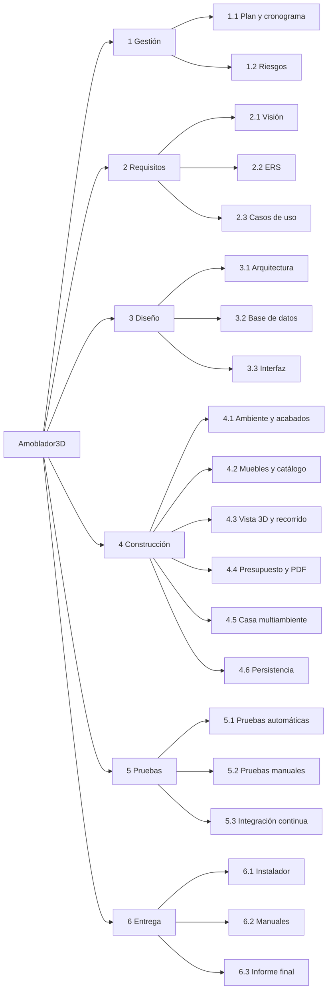
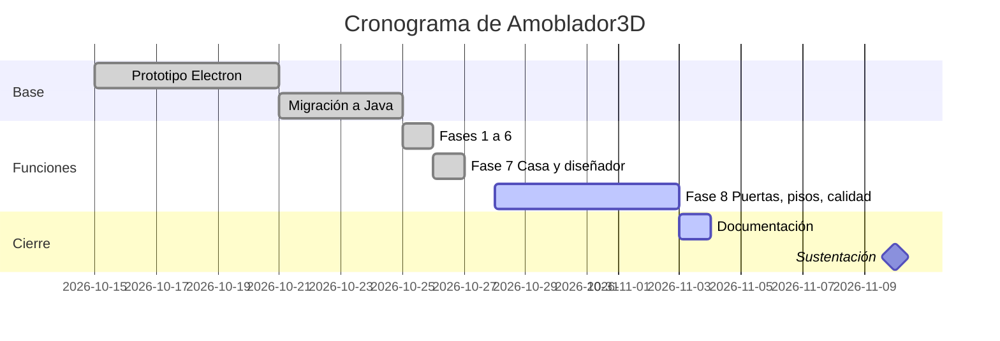

# 10 · Plan del proyecto, cronograma y riesgos

Versión 1.0 · noviembre de 2026

## 1. Metodología

Se usó un modelo **iterativo e incremental** con prácticas ágiles (inspirado en Scrum):

- Cada **fase** es un incremento que se puede usar: agrega funciones completas, con sus pruebas, su
  migración de base de datos y su documentación en el README.
- Una rama Git por fase (`fase-N-…`); se integra cuando todas las pruebas pasan.
- Al empezar cada fase se priorizan las funciones del documento de requisitos según el valor para
  el usuario (prioridad A antes que M y B).
- Al terminar cada fase: revisión del funcionamiento, corrección de defectos y actualización de los scripts SQL.

**Ciclo de vida según ISO/IEC 12207:** requisitos → diseño de la arquitectura → construcción → pruebas
→ integración → entrega, repetido en cada fase.

## 2. Estructura de desglose del trabajo (EDT)

<!-- Figura: Estructura de desglose del trabajo (EDT) -->

## 3. Cronograma (real, según el historial de Git)

<!-- Tabla: Cronograma real de fases y entregables -->
| Fase | Entregable | Inicio | Fin | Commit |
|---|---|---|---|---|
| 0 | Prototipo Electron + Three.js | — | 2026-10-21 | `d6d7335` |
| 1.x | Migración a Java + JavaFX + SQLite, correcciones, scripts SQL | 2026-10-21 | 2026-10-25 | `ff7373c`…`65f8e6e` |
| 1 | Metrado, presupuesto, PDF, medir | 2026-10-25 | 2026-10-25 | `8ef40e5` |
| 2 | Imán, selección múltiple, copiar/pegar, bloqueo | 2026-10-25 | 2026-10-25 | `a690de5` |
| 3 | Muebles nuevos, catálogo por categorías, plantillas | 2026-10-25 | 2026-10-25 | `650b5cc` |
| 4 | Recorrido, vistas, modo noche | 2026-10-25 | 2026-10-25 | `e99db7b` |
| 5 | Autoguardado e instalador | 2026-10-25 | 2026-10-25 | `2df95ef` |
| 6 | Columnas, muros, L, techo, zócalo | 2026-10-25 | 2026-10-25 | `3c42b81` |
| 7 | Casa multiambiente, diseñador de muebles | 2026-10-26 | 2026-10-27 | `fe6f6be` |
| 8 | Tipos de puerta, escaleras, pisos, registro de errores, CI, documentación | 2026-10-28 | 2026-11-03 | (pendiente) |

<!-- Figura: Diagrama de Gantt del proyecto -->

> El inicio del prototipo (15/10) y la fecha de sustentación (10/11) son estimados: `[completar]`
> con las fechas reales del curso.

## 4. Roles

<!-- Tabla: Roles y responsabilidades del equipo -->
| Rol | Responsabilidad | Integrante |
|---|---|---|
| Jefe de proyecto | Planificación, seguimiento, coordinación con el docente | `[completar]` |
| Analista | Requisitos y casos de uso | `[completar]` |
| Arquitecto / desarrollador | Diseño, código, base de datos | `[completar]` |
| Responsable de calidad | Pruebas y revisión | `[completar]` |
| Documentador | Manuales e informe | `[completar]` |

## 5. Gestión de riesgos

Probabilidad e impacto: 1 (bajo) a 3 (alto). Exposición = P × I.

<!-- Tabla: Matriz de riesgos del proyecto -->
| Id | Riesgo | P | I | Exp. | Respuesta | Estado |
|---|---|---|---|---|---|---|
| R1 | Rendimiento 3D bajo en PCs de laboratorio | 2 | 3 | 6 | Reconstruir solo lo que cambia; materiales compartidos; texturas con caché | Mitigado |
| R2 | Pérdida de trabajo por cortes de luz | 3 | 3 | 9 | Autoguardado cada 60 s y guardado en transacción | Mitigado |
| R3 | Cambios de base de datos que rompen proyectos antiguos | 2 | 3 | 6 | Migraciones numeradas con prueba automática | Mitigado |
| R4 | El usuario no tiene Java instalado | 3 | 2 | 6 | Instalador con Java incluido | Mitigado |
| R5 | Modelos 3D de internet con escala u orientación incorrecta | 3 | 1 | 3 | Diálogo de importación que corrige medidas y giro | Mitigado |
| R6 | Clases muy grandes difíciles de mantener (`MainWindow`) | 3 | 2 | 6 | Documentar la deuda técnica; refactorizar por controladores | Abierto |
| R7 | Errores en producción sin información para diagnosticarlos | 2 | 2 | 4 | Registro de errores con trazas | Mitigado (2.0.0) |
| R8 | Retraso en la entrega por ampliar el alcance | 2 | 3 | 6 | Fases cortas, cada una entregable; alcance cerrado en el doc. 01 | Controlado |
| R9 | Licencias de modelos 3D de terceros | 1 | 2 | 2 | Muebles paramétricos propios; texturas generadas por código | Mitigado |

## 6. Estimación de costos (referencial)

<!-- Tabla: Estimación referencial de costos -->
| Concepto | Cantidad | Costo unitario (S/) | Total (S/) |
|---|---|---|---|
| Horas de desarrollo | `[completar]` h | `[completar]` | `[completar]` |
| Software (JDK, JavaFX, SQLite, Maven, IntelliJ Community, Git) | — | 0 (libre) | 0 |
| Hosting del repositorio y CI (GitHub) | — | 0 (plan gratuito) | 0 |
| Computadora de desarrollo (ya disponible) | 1 | — | — |
| **Total** | | | `[completar]` |

Todo el software usado es libre o gratuito, por lo que el costo del producto es solo el de las horas de trabajo.
