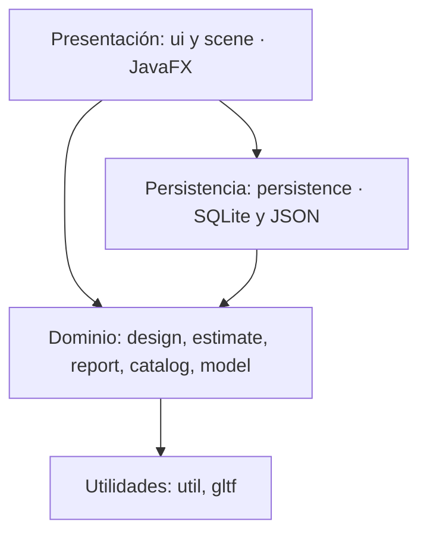
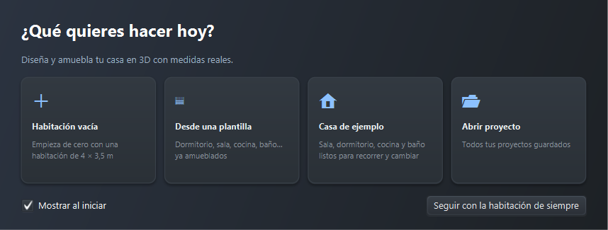
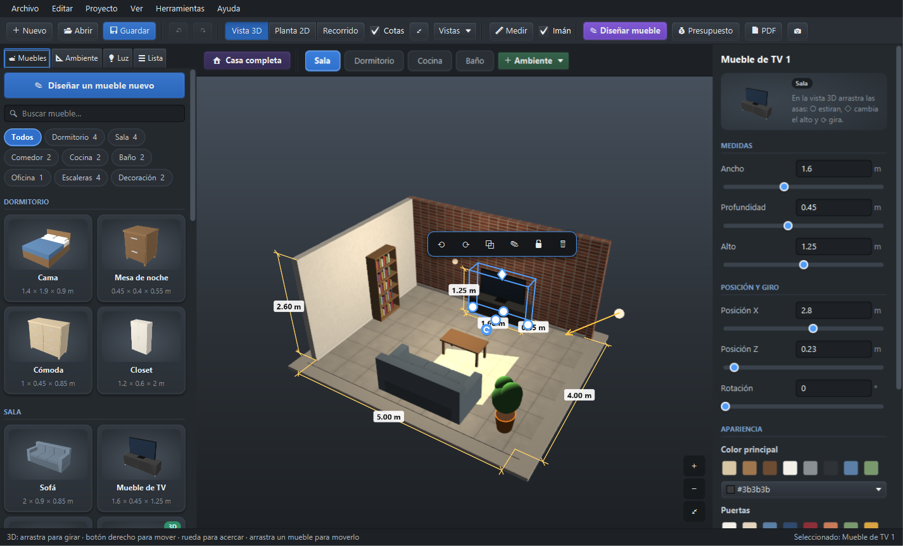
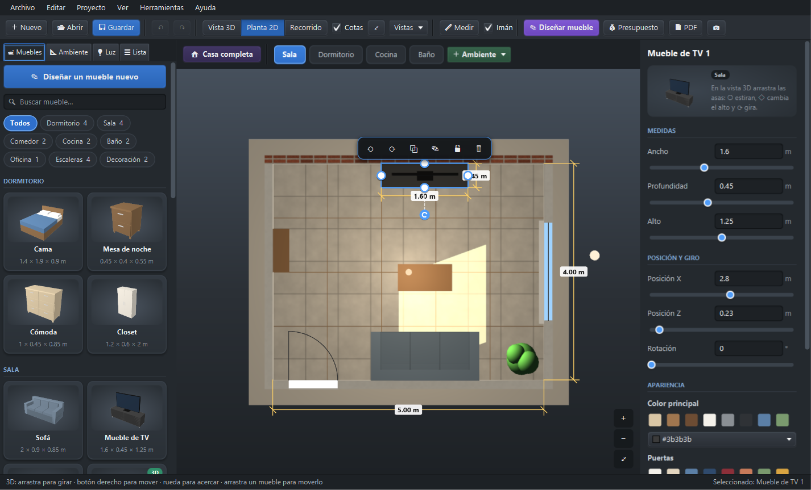
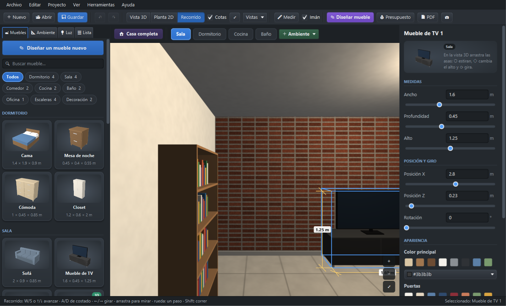
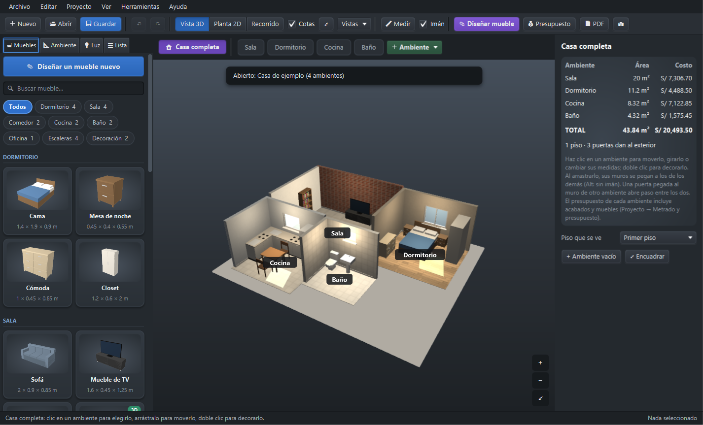
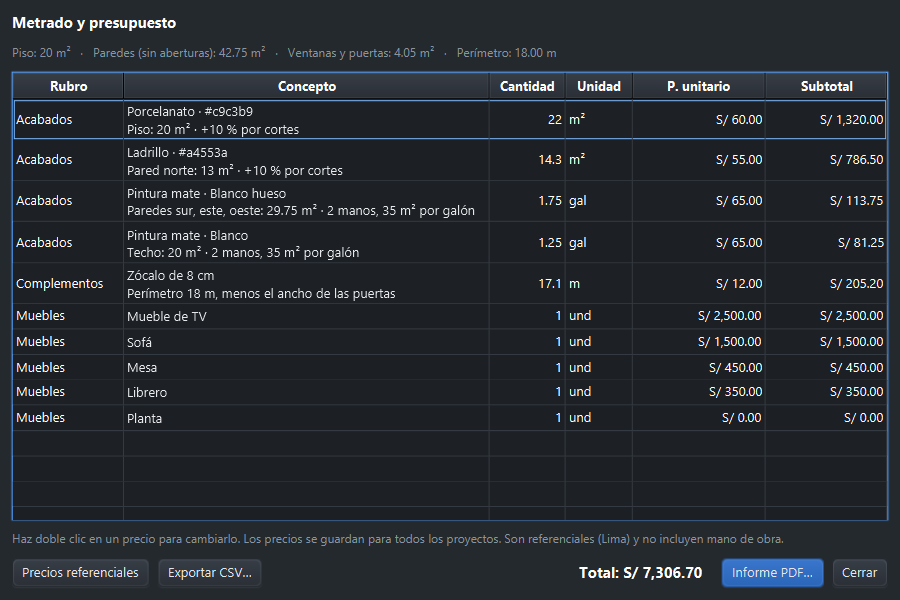
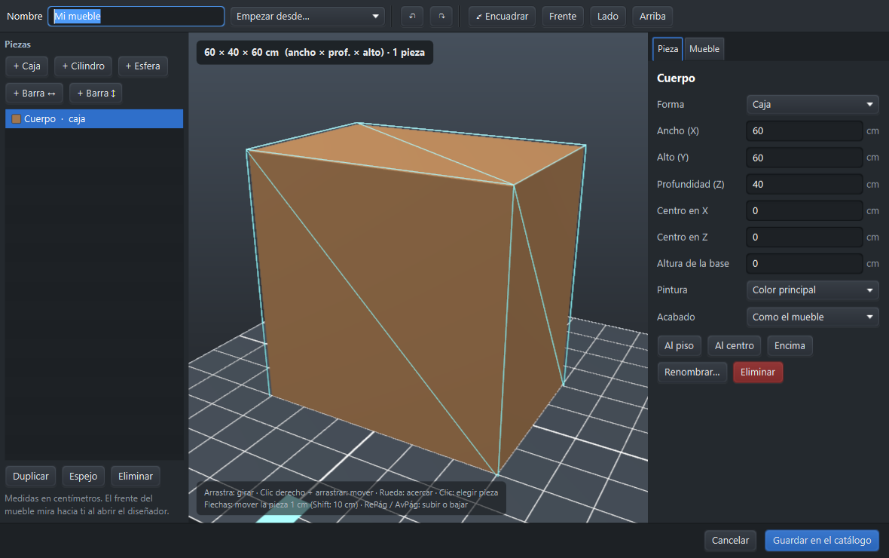

# UNIVERSIDAD NACIONAL DE JULIACA

### Escuela Profesional de `[completar]`

### Curso: `[completar]`

&nbsp;

# INFORME FINAL DEL PROYECTO

## Amoblador3D: aplicación de escritorio para el diseño de interiores en 3D con medidas reales y estimación de presupuesto

&nbsp;

**Docente:** `[completar]`

**Integrantes:**
- `[Apellidos y nombres — código]`
- `[Apellidos y nombres — código]`

**Semestre:** `[completar]`

Juliaca – Perú, noviembre de 2026

---

## Resumen

El presente proyecto tuvo como objetivo desarrollar una aplicación de escritorio que permita diseñar
y amoblar los ambientes de una vivienda en tres dimensiones con medidas reales y estimar el costo de
sus acabados y muebles. Se siguió un modelo de desarrollo iterativo e incremental de ocho fases, con
Java 21, JavaFX para la interfaz y la visualización 3D, SQLite como base de datos embebida y JUnit 5
para las pruebas automatizadas. El producto, Amoblador3D 2.0.0, permite definir ambientes
rectangulares o en L con columnas y muros internos, componer casas de hasta treinta ambientes en
cuatro pisos, colocar ventanas, seis tipos de puerta, luces y muebles que no pueden superponerse ni
bloquear el paso, elegir entre once materiales de acabado, recorrer el diseño en primera persona y
obtener el metrado de materiales con un presupuesto en soles y un informe PDF. Las colisiones se
resolvieron con el teorema del eje separador aplicado a rectángulos orientados. Se ejecutaron 114
pruebas automatizadas con un 100 % de aprobación y una cobertura de instrucciones entre 74 % y 92 %
en los paquetes de reglas, presupuesto, persistencia y lectura de modelos. A diferencia de los
antecedentes revisados, centrados en la realidad aumentada sobre dispositivos móviles, la solución
funciona sin conexión a internet y añade la validación física de la distribución y el cálculo del
presupuesto. Se concluye que es viable ofrecer una herramienta gratuita y de aprendizaje rápido que
ayude a las familias a decidir el amoblamiento de su vivienda antes de comprar.

**Palabras clave:** diseño de interiores, visualización 3D, JavaFX, detección de colisiones,
metrado, presupuesto.

## Abstract

This project aimed to develop a desktop application to design and furnish the rooms of a house in
three dimensions using real measurements and to estimate the cost of finishes and furniture. An
iterative and incremental process in eight phases was followed, using Java 21, JavaFX for the user
interface and 3D rendering, SQLite as an embedded database, and JUnit 5 for automated testing. The
resulting product, Amoblador3D 2.0.0, supports rectangular and L-shaped rooms with columns and
interior walls, houses of up to thirty rooms on four floors, windows, six door types, lights and
furniture that cannot overlap or block doorways, eleven finishing materials, a first-person
walkthrough, and a quantity take-off with a budget in Peruvian soles and a PDF report. Collisions
were solved with the separating axis theorem on oriented rectangles. All 114 automated tests passed,
with 74 % to 92 % instruction coverage in the rules, budgeting, persistence and model-loading
packages. Unlike the reviewed background studies, which focus on mobile augmented reality, the
solution works offline and adds physical validation of the layout and budget estimation. It is
concluded that a free, easy-to-learn tool can help families decide how to furnish their homes
before buying.

**Keywords:** interior design, 3D visualization, JavaFX, collision detection, quantity take-off, budgeting.

---

## Índice

(Se genera automáticamente en la versión Word.)

---

## Introducción

Amoblar o remodelar una vivienda implica decisiones costosas que normalmente se toman sin
herramientas: se compra un mueble que luego no entra, se tapa una ventana o se adquiere pintura y
cerámico de más. Las herramientas profesionales de diseño asistido por computadora resuelven el
problema, pero su costo y su curva de aprendizaje las alejan del usuario común; por su parte, las
aplicaciones de realidad aumentada para muebles se orientan a la venta de un catálogo concreto y no
validan la distribución completa de un ambiente ni calculan los materiales.

Este informe presenta Amoblador3D, una aplicación de escritorio que combina la visualización 3D con
reglas que reflejan la realidad física de un ambiente y con el cálculo del metrado y del presupuesto
en soles. El capítulo I plantea el problema y los objetivos; el capítulo II revisa los antecedentes y
los conceptos en que se basa la solución; el capítulo III describe la metodología; el capítulo IV, el
desarrollo; y el capítulo V, los resultados y su discusión. Finalmente se presentan las conclusiones,
las recomendaciones, las referencias y los anexos.

---

## Capítulo I: Planteamiento del problema

### 1.1 Descripción de la realidad problemática

Las familias y los pequeños contratistas deciden la distribución de los muebles y la compra de
acabados a partir de medidas tomadas a mano y de la intuición. Los errores más comunes son: muebles
que no caben o que bloquean puertas y ventanas, colores que no combinan una vez aplicados y compras
de material mal calculadas, que obligan a devolver productos o a hacer compras adicionales.

Las soluciones disponibles no cubren este problema de forma completa. Los programas de diseño
asistido por computadora exigen formación técnica y licencias de pago. Las aplicaciones móviles de
realidad aumentada, como las revisadas en el capítulo II, muestran un mueble del catálogo de una
empresa sobre la cámara del teléfono, pero no representan el ambiente con sus medidas, no impiden
ubicaciones imposibles y no estiman el costo de los acabados. Además, muchas dependen de una
conexión permanente a internet.

### 1.2 Formulación del problema

**Problema general:** ¿Cómo apoyar a los usuarios en el diseño y amoblamiento de los ambientes de su
vivienda con medidas reales y en la estimación del costo de sus acabados?

**Problemas específicos:**

1. ¿Cómo representar ambientes y casas con medidas reales en una aplicación accesible?
2. ¿Cómo evitar ubicaciones imposibles de muebles, puertas y ventanas?
3. ¿Cómo mostrar el diseño de forma comprensible para una persona sin formación técnica?
4. ¿Cómo calcular el metrado y el presupuesto de los acabados?
5. ¿Cómo asegurar que los proyectos del usuario no se pierdan y que la aplicación funcione correctamente?

### 1.3 Objetivos

**Objetivo general:** Desarrollar una aplicación de escritorio que permita diseñar y amoblar
ambientes de una vivienda en 3D con medidas reales y estimar el costo de sus acabados y muebles.

**Objetivos específicos:**

1. Modelar ambientes y casas de varios ambientes y pisos con medidas interiores reales.
2. Implementar reglas automáticas de validación de la ubicación de muebles y aberturas.
3. Visualizar el diseño en 3D, en planta y en recorrido en primera persona.
4. Calcular el metrado de acabados y un presupuesto referencial en soles.
5. Persistir los proyectos de forma confiable y verificar la calidad con pruebas automatizadas.

### 1.4 Justificación

- **Social:** ayuda a familias sin acceso a profesionales de diseño a planificar su vivienda.
- **Económica:** reduce las compras equivocadas de muebles y materiales; la herramienta es gratuita y
  se construyó solo con software libre.
- **Tecnológica:** aplica gráficos 3D, geometría computacional y bases de datos embebidas en una
  aplicación de escritorio que funciona sin internet.
- **Académica:** integra contenidos de ingeniería de requisitos, diseño de software, bases de datos,
  pruebas y gestión de proyectos.

### 1.5 Alcances y limitaciones

**Alcances:** ambientes rectangulares o en L con columnas y muros internos; casas de hasta 30
ambientes en 4 pisos; 18 muebles paramétricos, modelos 3D importados y un diseñador de muebles;
11 materiales; luces y modo noche; metrado, presupuesto, CSV e informe PDF; instalador para Windows.

**Limitaciones:**

- Las paredes solo forman ángulos de 90°; no hay muros curvos ni inclinados.
- Los precios son referenciales (Lima, 2026) y no incluyen mano de obra.
- No hay trabajo colaborativo en línea ni versión móvil.
- No se realizó una prueba de usabilidad con usuarios finales (se propone en las recomendaciones).

---

## Capítulo II: Marco teórico

### 2.1 Antecedentes

Los antecedentes se buscaron en repositorios institucionales y en el portal ALICIA de CONCYTEC con
los términos *diseño de interiores*, *realidad virtual*, *realidad aumentada*, *muebles* y
*visualización 3D*. Se seleccionaron los trabajos con relación directa con la visualización de
muebles o de espacios interiores.

#### 2.1.1 Antecedentes internacionales

**Barale Gottero, Caiafa Morel y Cambra Maldonado (2025)**, en su trabajo final de carrera
*HomeDesign: Plataforma para visualizar muebles desde el hogar mediante realidad aumentada*
(Universidad ORT Uruguay), tuvieron como objetivo facilitar la construcción, remodelación y
decoración de viviendas mediante un producto mínimo viable que permite ver muebles en el propio
espacio del usuario en tiempo real. Desarrollaron un portal web para que las empresas gestionen sus
catálogos y una aplicación móvil para los consumidores, con .NET Core, React, React Native y
despliegue continuo con GitHub Actions, e incorporaron escaneo 3D y un catálogo interactivo.
**Relación con el proyecto:** comparte el objetivo de decidir antes de comprar y el uso de
integración continua; se diferencia en que HomeDesign depende de la cámara del teléfono y de
servicios en la nube, mientras que Amoblador3D modela el ambiente completo y funciona sin conexión.

**Bolaños Mejía (2019)**, en su trabajo de titulación *Desarrollo de una aplicación basada en
realidad aumentada para facilitar a los clientes la visualización del mobiliario a fabricarse en la
empresa GrafMuebles S.A. mediante el uso de un teléfono inteligente* (Universidad Tecnológica
Israel, Quito), desarrolló con Unity 3D, el SDK Vuforia y Android Studio una aplicación que muestra
juegos de dormitorio, cocina y sala sobre marcadores impresos, con botones para cambiar colores y
texturas, y la evaluó mediante encuestas a usuarios. **Relación con el proyecto:** coincide en
mostrar el mueble con sus colores y materiales antes de fabricarlo o comprarlo; Amoblador3D añade la
edición de medidas, la validación de colisiones y el cálculo de materiales.

#### 2.1.2 Antecedentes nacionales

**Pérez Puchuri y Matos Talledo (2022)**, en su tesis *La aplicación del diseño modular en los
espacios reducidos de una vivienda multifamiliar en Lima, Perú* (Escuela de Educación Superior
Tecnológica Privada Toulouse Lautrec), buscaron demostrar que los espacios reducidos pueden
organizarse para aprovechar al máximo sus dimensiones, mediante una propuesta de diseño modular para
un departamento piloto representada con vistas 3D del mobiliario. **Relación con el proyecto:**
justifica la necesidad de planificar la distribución con medidas reales en viviendas pequeñas, que es
el caso de uso principal de Amoblador3D.

**Benites Moreno y Bocanegra Siu (2021)**, en su tesis de maestría *Realidad aumentada para el
sector retail* (Universidad de Lima), plantearon el plan de negocios de *Mira como Queda*, una
aplicación móvil de realidad aumentada para comprar muebles y artefactos del hogar. A partir del
análisis del comercio electrónico de muebles en el Perú y de una encuesta a compradores digitales,
concluyeron que el proyecto es viable y rentable. **Relación con el proyecto:** evidencia la demanda
local de herramientas que permitan ver cómo quedará un mueble antes de comprarlo.

**Ruiz Gamarra (2020)**, en su tesis de maestría *Sistema de gestión y visualización de diseños CAD
mediante realidad virtual. Caso: sector diseño y manufactura en Perú* (Universidad Científica del
Sur), analizó cómo implementar un sistema de realidad virtual en una empresa manufacturera para
gestionar diseños CAD y validar los productos antes de producirlos, con la capacitación de los
especialistas y un modelo de implementación ordenado. **Relación con el proyecto:** respalda la
validación virtual de un diseño antes de ejecutarlo para reducir riesgos y costos, principio que
Amoblador3D aplica al amoblamiento con el recorrido en primera persona.

#### 2.1.3 Antecedentes locales

En la búsqueda realizada no se identificaron trabajos de la región Puno sobre aplicaciones de diseño
de interiores. `[completar si el docente exige antecedentes locales: revisar el repositorio
institucional de la UNAJ y de la UNA Puno]`

### 2.2 Bases teóricas

**Gráficos 3D por computadora.** Una escena 3D se compone de mallas de triángulos, materiales que
definen cómo reflejan la luz y fuentes de luz. JavaFX ofrece un grafo de escena con primitivas
(cajas, cilindros, esferas), mallas arbitrarias, materiales de tipo Phong (color difuso más un reflejo
especular controlado por su intensidad y tamaño) y luces puntuales, focales y direccionales
(OpenJFX, 2024). Amoblador3D usa los materiales Phong para los acabados mate, satinado, brillante y
metálico.

**Cámaras y proyecciones.** La vista 3D usa una cámara en perspectiva que orbita alrededor de un
punto; la planta usa una vista cenital, y el recorrido ubica la cámara a la altura de los ojos y la
desplaza sin atravesar obstáculos.

**Detección de colisiones con el teorema del eje separador.** Dos polígonos convexos no se intersecan
si existe un eje sobre el cual sus proyecciones no se solapan. Para dos rectángulos orientados basta
probar los cuatro ejes normales a sus lados (Ericson, 2005). Se aplica a la huella en planta de cada
mueble, de las columnas y del área de giro de las puertas.

**Formato glTF 2.0.** Estándar abierto de Khronos Group para transmitir modelos 3D, con una variante
binaria (`.glb`) que empaqueta geometría, materiales y texturas (Khronos Group, 2021).

**Metrado.** Cuantificación de las partidas de obra: áreas de muros descontando vanos, áreas de piso y
longitudes de zócalo. Se usan rendimientos comerciales: un galón de pintura látex cubre cerca de
35 m² por mano y los pisos se compran con un 10 % de desperdicio por cortes.

**Bases de datos embebidas.** SQLite es un motor relacional transaccional que se ejecuta dentro de la
aplicación y guarda toda la base en un solo archivo (SQLite, 2024).

**Arquitectura en capas y patrones de diseño.** Separar presentación, dominio y persistencia reduce el
acoplamiento y permite probar las reglas sin la interfaz (Sommerville, 2016). En el proyecto se usan
el patrón *fachada* (la clase `Design` concentra las reglas), el patrón *observador* (la vista 3D se
suscribe a los cambios del diseño) y el patrón *memento* (el historial guarda una copia del proyecto
para deshacer).

**Calidad y pruebas del software.** La norma ISO/IEC 25010 define características como adecuación
funcional, fiabilidad, usabilidad y mantenibilidad, que se usaron para formular los requisitos no
funcionales (International Organization for Standardization [ISO], 2023). Las pruebas unitarias
verifican componentes aislados y las de integración la colaboración entre ellos; automatizarlas
permite detectar regresiones en cada cambio (Pressman y Maxim, 2020).

### 2.3 Definición de términos básicos

| Término | Definición |
|---|---|
| Ambiente | Habitación de la vivienda con sus medidas, aberturas, luces y muebles |
| Abertura | Ventana o puerta sobre una pared |
| Metrado | Cálculo de cantidades de obra (m², m, unidades) |
| Mueble paramétrico | Mueble generado por código a partir de su ancho, profundidad y alto |
| Huella | Rectángulo que ocupa un objeto visto desde arriba |
| Regresión | Error que aparece en algo que antes funcionaba, por un cambio posterior |
| Cobertura de código | Porcentaje del código que ejecutan las pruebas automatizadas |

---

## Capítulo III: Metodología

### 3.1 Tipo y enfoque

Proyecto de investigación aplicada de tipo tecnológico: produce un artefacto de software para
resolver un problema práctico. El enfoque es cuantitativo en la verificación (número de pruebas,
cobertura, cumplimiento de requisitos).

### 3.2 Método de desarrollo

Se siguió un modelo **iterativo e incremental** con prácticas ágiles. Cada fase entregó un incremento
funcional y probado, en su propia rama de Git, con su migración de base de datos y su documentación.

| Fase | Incremento |
|---|---|
| Base | Migración a Java, escena 3D, acabados, proyectos en SQLite |
| 1 | Metrado, presupuesto, informe PDF, herramienta de medir |
| 2 | Imán, selección múltiple, copiar y pegar, bloqueo |
| 3 | Muebles nuevos, catálogo por categorías, plantillas |
| 4 | Recorrido en primera persona, vistas guardadas, modo noche |
| 5 | Autoguardado con recuperación, instalador para Windows |
| 6 | Columnas, muros internos, habitación en L, techo, zócalo |
| 7 | Casa con varios ambientes, diseñador de muebles |
| 8 | Tipos de puerta, escaleras, pisos, registro de errores, integración continua |

### 3.3 Técnicas e instrumentos

| Técnica | Instrumento | Uso |
|---|---|---|
| Revisión documental | Repositorios institucionales, ALICIA, normas técnicas | Antecedentes y bases teóricas |
| Especificación de requisitos | Plantilla IEEE 830 / ISO 29148 | Requisitos funcionales y no funcionales |
| Pruebas automatizadas | JUnit 5 | Verificación de reglas, persistencia y lectura de modelos |
| Medición de cobertura | JaCoCo | Porcentaje de código probado |
| Pruebas de sistema | Lista de comprobación manual (documento 06) | Flujos de la interfaz |
| Integración continua | GitHub Actions | Compilación y pruebas en cada cambio |

### 3.4 Herramientas

| Categoría | Herramienta |
|---|---|
| Lenguaje | Java 21 |
| Interfaz y 3D | JavaFX 21 |
| Base de datos | SQLite 3 (y script PostgreSQL para consultas) |
| Librerías | Gson (JSON), Apache PDFBox (PDF) |
| Construcción | Maven con Maven Wrapper |
| Pruebas y calidad | JUnit 5, JaCoCo, GitHub Actions |
| Control de versiones | Git y GitHub |
| Empaquetado | jpackage (instalador para Windows) |

---

## Capítulo IV: Desarrollo de la solución

### 4.1 Requisitos

Se especificaron 40 requisitos funcionales y 14 no funcionales (documento 02) y 11 casos de uso
(documento 03).

| Grupo | Requisitos funcionales | Ejemplos |
|---|---|---|
| Ambiente y casa | RF-01 a RF-09 | Medidas de 1 a 30 m; seis tipos de puerta; hasta 4 pisos |
| Acabados | RF-10 a RF-13 | 11 materiales; zócalo configurable |
| Muebles | RF-14 a RF-23 | Catálogo con buscador; sin colisiones; diseñador por piezas |
| Visualización | RF-24 a RF-28 | 3D, planta, recorrido; luces; medir |
| Presupuesto e informes | RF-29 a RF-33 | Metrado; precios editables; CSV y PDF |
| Proyectos | RF-34 a RF-40 | SQLite; `.amob3d`; deshacer; autoguardado |

### 4.2 Arquitectura

Se adoptó una arquitectura en capas en la que las reglas del negocio no dependen de la interfaz
gráfica, lo que permitió probarlas sin abrir ventanas (documento 04).



### 4.3 Base de datos

Once tablas en SQLite (esquema v9) con migraciones automáticas: al abrir una base antigua se aplican
en orden, cada una en su transacción, los pasos que faltan (documento 05).

### 4.4 Algoritmos principales

**Validación de colisiones.** Antes de aceptar un movimiento, la clase `Design` construye la huella
del mueble en su nueva posición y la compara con las paredes, las columnas, los demás muebles y el
área de giro de cada puerta:

```
para cada obstáculo O del ambiente:
    para cada eje E normal a un lado de la huella M o de O:
        proyectar M y O sobre E
        si las proyecciones no se solapan: M no choca con O (pasar al siguiente obstáculo)
    si en ningún eje se separan: rechazar el movimiento y explicar con qué choca
aceptar el movimiento
```

**Cálculo del metrado.** Para cada superficie:

| Concepto | Fórmula |
|---|---|
| Área de paredes | perímetro × alto − Σ (ancho × alto de cada ventana y puerta) + caras visibles de columnas |
| Pintura (galones) | área × 2 manos ÷ 35 m², redondeado hacia arriba al cuarto de galón |
| Pisos y enchapes (m²) | área × 1,10 (10 % de desperdicio) |
| Zócalo (m) | perímetro − Σ ancho de las puertas |
| Costo | cantidad × precio unitario (referencial o del usuario) |

### 4.5 Interfaz

La interfaz se organiza en una barra de herramientas, un panel lateral con el catálogo y las
propiedades del ambiente, la vista central y un panel de propiedades del elemento seleccionado.















---

## Capítulo V: Resultados

### 5.1 Cumplimiento de objetivos

| Objetivo específico | Resultado | Logro |
|---|---|---|
| OE1 Modelar ambientes y casas | Ambientes de 1 a 30 m, en L, con columnas; casas de hasta 30 ambientes en 4 pisos | Logrado |
| OE2 Validar ubicaciones | Colisiones con paredes, columnas, muebles y giro de puertas; aberturas sin superposición | Logrado |
| OE3 Visualizar | Vista 3D, planta con cotas y recorrido sin atravesar objetos | Logrado |
| OE4 Metrado y presupuesto | Áreas descontando vanos y columnas; pintura, pisos, zócalo y muebles en S/; CSV y PDF | Logrado |
| OE5 Persistencia y calidad | Transacciones, autoguardado, migraciones v1 a v9; 114 pruebas al 100 % | Logrado |

### 5.2 Resultados de las pruebas

Se ejecutaron 114 casos automatizados en 20 clases de prueba, con 100 % de aprobación (03/11/2026).
La construcción exige al menos 70 % de cobertura en los paquetes de dominio y datos.

| Paquete | Cobertura de instrucciones | Cobertura de ramas |
|---|---|---|
| `estimate` (presupuesto) | 92 % | 84 % |
| `model` (entidades) | 89 % | 75 % |
| `persistence` (base de datos y archivos) | 89 % | 72 % |
| `report` (informe PDF) | 89 % | 83 % |
| `gltf` (modelos 3D) | 79 % | 58 % |
| `design` (reglas) | 78 % | 63 % |
| `catalog` (catálogo) | 74 % | 52 % |
| Total del proyecto (incluye interfaz) | 40 % | — |

La interfaz gráfica (paquetes `ui` y `scene`) se verificó con la lista de comprobación manual del
documento 06.

### 5.3 Métricas del producto

| Métrica | Valor |
|---|---|
| Líneas de código Java (producción y pruebas) | ≈ 19 400 |
| Clases de producción | 85 |
| Clases de prueba | 20 |
| Muebles paramétricos | 18 |
| Materiales de acabado | 11 |
| Tablas de la base de datos | 11 |
| Versiones del esquema de datos migradas sin pérdida | 9 |

### 5.4 Discusión

Los antecedentes internacionales (Barale Gottero et al., 2025; Bolaños Mejía, 2019) y el nacional de
Benites Moreno y Bocanegra Siu (2021) coinciden con este proyecto en que el usuario necesita ver
cómo quedará un mueble antes de comprarlo o fabricarlo. Sin embargo, sus soluciones superponen un
mueble del catálogo de una empresa sobre la imagen de la cámara y no representan el ambiente con sus
medidas. Amoblador3D aborda un problema más amplio: la distribución completa de uno o varios
ambientes, con reglas que impiden ubicaciones imposibles, lo que en las pruebas se verificó en casos
como un mueble frente a una puerta o un ambiente sin espacio libre.

Pérez Puchuri y Matos Talledo (2022) muestran que el aprovechamiento de espacios reducidos depende de
planificar con medidas reales; Amoblador3D convierte esa planificación en una tarea que el propio
usuario puede hacer, y añade el metrado y el presupuesto, que ninguno de los antecedentes revisados
incluye. A su vez, Ruiz Gamarra (2020) sostiene que validar un diseño en un entorno virtual antes de
ejecutarlo reduce riesgos y costos; el recorrido en primera persona de Amoblador3D aplica ese
principio sin requerir visores de realidad virtual.

Como limitación frente a los antecedentes móviles, Amoblador3D no superpone el diseño sobre el
espacio real mediante la cámara y no se evaluó con encuestas a usuarios, como sí lo hizo Bolaños
Mejía (2019). Estas diferencias se recogen en las recomendaciones.

---

## Conclusiones

1. Se desarrolló Amoblador3D 2.0.0, una aplicación de escritorio gratuita que funciona sin conexión a
   internet y permite diseñar y amoblar ambientes y casas completas en 3D con medidas reales, con lo
   que se cumplió el objetivo general.
2. Se modelaron ambientes de 1 a 30 m, en L y con columnas, y casas de hasta 30 ambientes en cuatro
   pisos, con medidas interiores y muros que crecen hacia afuera (OE1).
3. El teorema del eje separador aplicado a las huellas en planta permitió impedir de forma exacta que
   los muebles se superpongan o bloqueen el paso, incluso girados de 15 en 15 grados (OE2).
4. Las vistas 3D, en planta con cotas y en recorrido en primera persona permiten que una persona sin
   formación técnica comprenda el diseño (OE3).
5. El metrado con rendimientos comerciales y precios editables entrega un presupuesto útil para
   planificar las compras, aunque referencial (OE4).
6. Las transacciones, el autoguardado y las migraciones automáticas protegieron los datos a lo largo
   de nueve versiones del esquema; separar las reglas de la interfaz permitió automatizar 114 pruebas
   con 100 % de aprobación (OE5).

## Recomendaciones

1. Realizar una prueba de usabilidad con cinco a ocho usuarios y medir el tiempo que toman en
   amoblar una habitación, siguiendo los tutoriales del manual de usuario.
2. Continuar dividiendo la clase `MainWindow` en controladores más pequeños (ya se separó el catálogo).
3. Agregar pruebas automatizadas de la interfaz con TestFX.
4. Permitir paredes en ángulo y curvas en una versión futura.
5. Evaluar una versión móvil con realidad aumentada que reutilice el formato `.amob3d`, para mostrar
   el diseño sobre el espacio real, como en los antecedentes revisados.
6. Actualizar periódicamente los precios referenciales o permitir importarlos de una lista de precios.

## Referencias

Barale Gottero, A., Caiafa Morel, V., y Cambra Maldonado, F. (2025). *HomeDesign: Plataforma para
visualizar muebles desde el hogar mediante realidad aumentada* [Trabajo final de carrera,
Universidad ORT Uruguay]. Repositorio Académico Digital ORT. https://hdl.handle.net/20.500.11968/7696

Benites Moreno, M. M., y Bocanegra Siu, T. (2021). *Realidad aumentada para el sector retail* [Tesis de
maestría, Universidad de Lima]. Repositorio Institucional de la Universidad de Lima.
https://hdl.handle.net/20.500.12724/14797

Bolaños Mejía, L. W. (2019). *Desarrollo de una aplicación basada en realidad aumentada para
facilitar a los clientes la visualización del mobiliario a fabricarse en la empresa GrafMuebles S.A.
mediante el uso de un teléfono inteligente* [Trabajo de titulación, Universidad Tecnológica Israel].
Repositorio UISRAEL.
https://repositorio.uisrael.edu.ec/xmlui/bitstream/handle/47000/2197/UISRAEL-EC-ELDT-378.242-2019-088.pdf

Ericson, C. (2005). *Real-time collision detection*. Morgan Kaufmann.

International Organization for Standardization. (2023). *Systems and software engineering — Systems
and software Quality Requirements and Evaluation (SQuaRE) — Product quality model* (ISO/IEC 25010:2023).

Khronos Group. (2021). *glTF 2.0 specification*. https://registry.khronos.org/glTF/specs/2.0/glTF-2.0.html

OpenJFX. (2024). *JavaFX documentation*. https://openjfx.io

Pérez Puchuri, M. del C., y Matos Talledo, S. J. (2022). *La aplicación del diseño modular en los
espacios reducidos de una vivienda multifamiliar en Lima, Perú* [Tesis de título profesional,
Escuela de Educación Superior Tecnológica Privada Toulouse Lautrec]. Repositorio Toulouse Lautrec.
https://hdl.handle.net/20.500.12826/234

Pressman, R. S., y Maxim, B. R. (2020). *Software engineering: A practitioner's approach* (9.ª ed.).
McGraw-Hill.

Ruiz Gamarra, L. E. (2020). *Sistema de gestión y visualización de diseños CAD mediante realidad
virtual. Caso: sector diseño y manufactura en Perú* [Tesis de maestría, Universidad Científica del
Sur]. Repositorio de la Universidad Científica del Sur. https://hdl.handle.net/20.500.12805/1427

Sommerville, I. (2016). *Software engineering* (10.ª ed.). Pearson.

SQLite. (2024). *About SQLite*. https://www.sqlite.org/about.html

## Anexos

- Anexo A: Especificación de requisitos (documento 02)
- Anexo B: Casos de uso (documento 03)
- Anexo C: Documento de arquitectura (documento 04)
- Anexo D: Diseño de base de datos (documento 05)
- Anexo E: Plan y reporte de pruebas (documento 06)
- Anexo F: Manual de usuario (documento 07)
- Anexo G: Manual técnico (documento 08)
- Anexo H: Manual de instalación (documento 09)
- Anexo I: Repositorio del código: https://github.com/alex123floresc-sketch/amoblador3d
